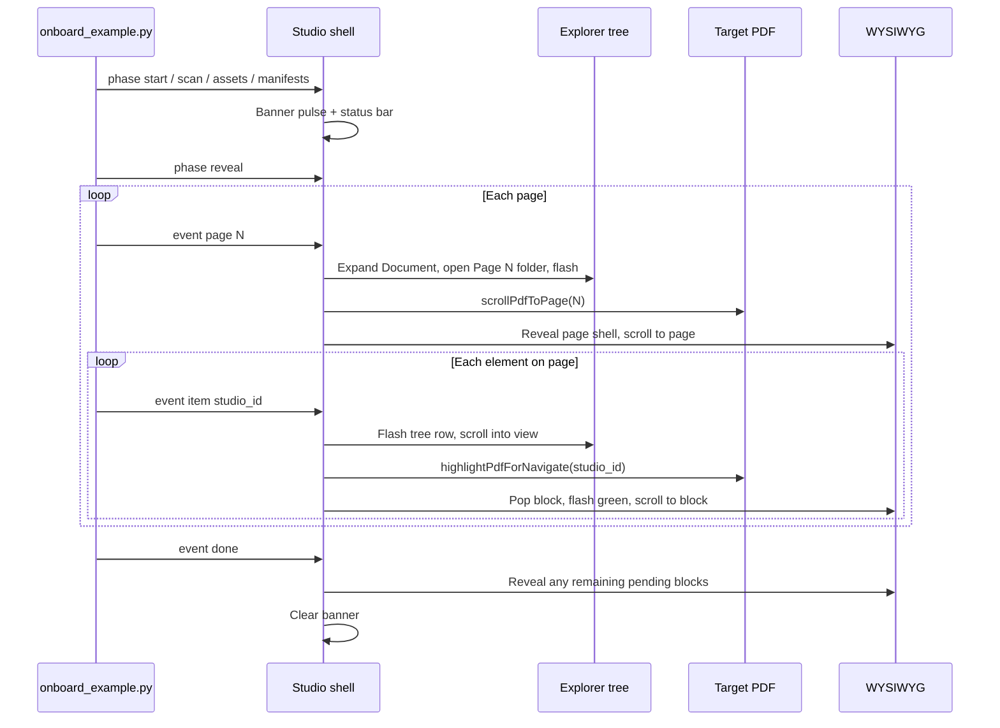

When Studio opens an example that has a **reference PDF only** (`status: reference_only`), it automatically **documents the PDF** (element boxes for every paragraph, image, table region, and page), writes manifests into the **same folder as the PDF**, and plays a **visual onboarding sequence** across all three panes.

**Deep dive on detection:** **`docs/PDF_ELEMENT_DETECTION.md`** — paragraphs, images, tables, titles, page numbers, box schema, and verification.

---

## Overview: two phases

| Phase | What happens | User sees |
|-------|--------------|-----------|
| **1. Document the PDF** | PyMuPDF scans the reference PDF; writes `element-windows.json` and related manifests | Status bar phases: “Reading PDF”, “Rendering guides”, “Writing manifests” |
| **2. Visual reveal** | Studio replays a timeline — one element at a time | Explorer tree expands and **flashes**; PDF tints **highlight**; WYSIWYG blocks **pop in** and **scroll** into view |

Phase 1 is mandatory. Phase 2 makes the first pass **interesting and inspectable** — you watch the datasheet assemble itself block by block.

---

## When it runs

| Trigger | Behavior |
|---------|----------|
| **Studio startup** | If the active example is `reference_only`, onboarding starts after panes load. |
| **Example switch** | Switching to a PDF-only example via **Example ▾** or right-click **Target** PDF triggers onboarding. |
| **API** | `POST /api/onboard/run` with `{ "example": "<slug>" }`. |
| **CLI** | `python tools/onboard_example.py <slug>` (files only; no animation). |

Examples with `document-outline.json` already present (`status: ready`) are **not** re-onboarded automatically.

---

## Step 1 — Document the PDF (boxes for all elements)

Before any WYSIWYG HTML is shown, `tools/onboard_example.py` measures the PDF and writes **`element-windows.json`** — one tinted rectangle per logical element.

### What gets detected (first pass)

| Element | Kind | Box color | Detection method |
|---------|------|-----------|------------------|
| **Page sheet** | `page` | Grey | Full 612×792 pt |
| **Paragraphs / bullets** | `text` | Blue | PyMuPDF text blocks (page numbers excluded) |
| **Section headings** | `text` | Blue | Same block; classified in WYSIWYG as `h2.section` |
| **Document title** | `text` | Blue | Page 1 largest heading block → `doc-title-block` |
| **Page numbers** | — | — | **Excluded** from explorer (footer band only) |
| **Product shot** | `link` | Purple | Page 1, first image ≥ 24×24 pt |
| **Figures / diagrams** | `asset` | Amber | Other embedded images |
| **Tables** | `table` | Green | **Planned** — grid line clustering; first pass may split table text into multiple blue blocks |

See **`docs/PDF_ELEMENT_DETECTION.md`** for algorithms, merge rules, and refinement path.

### Files written (same folder as `reference/*.pdf`)

All paths under `examples/<slug>/`:

| File | Purpose |
|------|---------|
| `assets/reference-pdf/page-{n}.png` | WYSIWYG alignment guide underlay (~28% opacity) |
| `assets/reference-pdf/page-{n}-img-{k}.*` | Embedded images extracted from PDF |
| `target-layout.json` | Index of page previews and extracted images |
| `element-windows.json` | **PDF tint boxes** — canonical bounds per element |
| `document-outline.json` | Explorer **Document** tree (from windows) |
| `spacing.json` | Block top/height from window bounds |
| `typography.json` | Font size histogram → Studio typography CSS |
| `colors.json` | Draft ink / band colors from PDF vector fills |
| `document-layout.json` | Copied from `examples/_template/` |
| `wysiwyg-body.html` | Editable scaffold; blocks start `onboard-pending` |
| `wysiwyg-overrides.json` | Empty overrides store (if missing) |
| `out/datasheet.pdf`, `baseline/datasheet.pdf` | Seeded from reference PDF |

After writing manifests:

- `python tools/generate_typography_css.py`
- `python tools/generate_document_column_css.py`
- `datasheet.yaml` → `studio.status: ready`

---

## Step 2 — Visual sequence (three panes in sync)

The Python onboarder returns an **`events[]`** timeline. `studio/app.js` → `playOnboardingSequence()` drives Explorer, PDF, and WYSIWYG together.

### Sequence diagram



### Phase events (banner + status bar)

| Event id | Label (typical) | Duration |
|----------|-----------------|----------|
| `start` | Reading target PDF | 550 ms |
| `scan` | Found N page(s) | 550 ms |
| `assets` | Rendering page guides and extracting images | 550 ms |
| `manifests` | Writing layout manifests | 550 ms |
| `css` | Regenerating Studio CSS | 550 ms |
| `reveal` | Building explorer tree | 550 ms |

Constant: `ONBOARD_PHASE_MS = 550` in `studio/app.js`.

### Page events

For each page:

1. **Explorer** — `Document` group expands; **Page N** folder opens with `onboard-expand-flash` + `onboard-flash` on the folder toggle.
2. **PDF** — scrolls to page N (`scrollPdfToPage`).
3. **WYSIWYG** — page `<article data-studio-id="page:N">` loses `onboard-pending`, gets `onboard-reveal`; pane scrolls to page.

Duration: `ONBOARD_PAGE_MS = 360` ms.

### Item events (one box at a time)

For each text block, image, or (future) table:

| Pane | Action |
|------|--------|
| **Explorer** | Matching tree row gets `onboard-flash` (blue pulse); row scrolls into view in the tree column |
| **PDF** | Active tint outline on the element window (`highlightPdfForNavigate`) |
| **WYSIWYG** | Block removes `onboard-pending` → `onboard-reveal` (pop-up) → `onboard-flash` (green pulse); pane scrolls to block |

Duration: `ONBOARD_ITEM_MS = 420` ms per item.

Tree selection updates (`selectedStudioId`) but the explorer does **not** auto-scroll on normal navigation rules — onboarding explicitly scrolls the tree row for each item.

### Done event

- All remaining `onboard-pending` WYSIWYG blocks are revealed.
- Banner shows “First pass complete” briefly, then hides.
- `body.onboarding-active` removed (sidebar inset border off).

---

## Explorer (left pane) behavior

During onboarding:

| Behavior | CSS / code |
|----------|------------|
| Target + Document groups forced open | `expandExplorerForPage()` |
| Page folder opens on first item of that page | `expandedGroups.add("page:N")` |
| Folder chevron flashes | `.onboard-expand-flash` |
| Active row flashes blue | `.tree-item.onboard-flash` → `@keyframes onboard-tree-flash` |
| Colored dots | Same hex as PDF tint (`kind_colors`) |
| Sidebar inset border | `body.onboarding-active .sidebar` |

Highlighting is forced **on** during onboarding (`paneHighlightsEnabled = true`).

---

## Target PDF (center pane) behavior

| Behavior | Implementation |
|----------|----------------|
| Scroll to page | `scrollPdfToPage` on `page` events |
| Tint on active element | `highlightPdfForNavigate(studio_id, page)` |
| Windows loaded before playback | `pushPdfElementWindows()` from fresh `element-windows.json` |

Passive tints visible throughout; active window gets stronger outline during each item event.

---

## WYSIWYG (right pane) behavior

| State | CSS | Visual |
|-------|-----|--------|
| Initial | `.onboard-pending` | Opacity 0, scale 0.96, translated down — **invisible** |
| Reveal | `.onboard-reveal` | `@keyframes onboard-block-pop` — scale up, green shadow ring |
| Flash | `.onboard-flash` | Green outline + background pulse |
| Page shell | `.pdf-page.onboard-reveal` | `@keyframes onboard-page-pop` |

After reload, `prepareWysiwygOnboardPending()` hides all blocks before playback.

Pane scroll: `scrollWysiwygPaneToElement(el, { syncPdf: false })` — PDF does not follow WYSIWYG scroll during onboarding (only explicit page/item events).

Chrome: `body.onboarding-active .wysiwyg-pane` — green inset border.

---

## Top banner

HTML: `#onboard-banner` / `#onboard-banner-text`

| State | Appearance |
|-------|--------------|
| Active | Pulsing gradient border (`@keyframes onboard-banner-pulse`) |
| Hidden | `.hidden` after completion or failure |

Shows current phase label during extraction; per-item labels during reveal.

---

## CLI (without Studio UI)

```powershell
cd D:\XDrive\datasheet
python tools/onboard_example.py current-sensor-cs
python tools/onboard_example.py current-sensor-cs --json
```

Requires `examples/<slug>/reference/*.pdf` on disk. Writes all manifests; prints event count. No animation.

---

## API

```http
POST /api/onboard/run
Content-Type: application/json

{ "example": "current-sensor-cs" }
```

Response:

```json
{
  "ok": true,
  "example": "current-sensor-cs",
  "files_written": ["element-windows.json", "document-outline.json", "wysiwyg-body.html"],
  "events": [
    { "type": "phase", "id": "scan", "label": "Found 3 page(s)", "page_count": 3 },
    { "type": "page", "page": 1, "label": "Page 1", "studio_id": "page:1" },
    {
      "type": "item",
      "studio_id": "text:p1-current-sensors",
      "label": "Current Sensors",
      "page": 1,
      "kind": "text",
      "color": "#4c8bf5"
    },
    { "type": "done", "label": "First pass complete", "item_count": 28 }
  ],
  "project": { "example_status": "ready", "needs_onboard": false }
}
```

---

## Timing and animation reference

| Constant | Default | Used for |
|----------|---------|----------|
| `ONBOARD_PHASE_MS` | 550 ms | Phase labels |
| `ONBOARD_PAGE_MS` | 360 ms | Page folder expand |
| `ONBOARD_ITEM_MS` | 420 ms | Per-element reveal |

| Stylesheet | Animations |
|------------|------------|
| `studio/styles.css` | `onboard-banner-pulse`, `onboard-tree-flash`, `onboard-expand-flash`, `onboarding-active` chrome |
| `studio/target-wysiwyg.css` | `onboard-block-pop`, `onboard-page-pop`, `onboard-block-flash`, `onboard-pending` |

Implementation: `playOnboardingSequence()`, `revealWysiwygBlock()`, `flashExplorerItem()`, `flashExplorerPageFolder()` in `studio/app.js`.

---

## After onboarding

The first pass is a **starting point**, not pixel-perfect:

1. **Review boxes on the PDF** — tints should wrap each paragraph and figure. Double-click to resize (`docs/ELEMENT_WINDOW_RESIZE.md`).
2. **Merge / split blocks** — run refined extractors or edit `element-windows.json`.
3. **Tables** — when generic table detection lands, re-run onboard or `generate_table_css.py`.
4. **Edit WYSIWYG** — text saves to `wysiwyg-overrides.json`.
5. **Production bar** — solar-lora-sensor + `docs/WYSIWYG_MATCH_RULES.md`.

Full manifest checklist: **`docs/DOCUMENT_LAYOUT.md`** §8.

---

## Related

| Doc | Topic |
|-----|-------|
| **`docs/PDF_ELEMENT_DETECTION.md`** | Deep dive: paragraphs, images, tables, titles, page numbers |
| **`docs/EXAMPLE_SWITCHING.md`** | `reference_only` vs `ready` |
| **`docs/STUDIO.md`** | Three-pane UI |
| **`docs/ELEMENT_WINDOW_RESIZE.md`** | Manual box editing |
| **`docs/DATA_HOME.md`** | Canonical paths |
| **`tools/onboard_example.py`** | Generator + event timeline |
