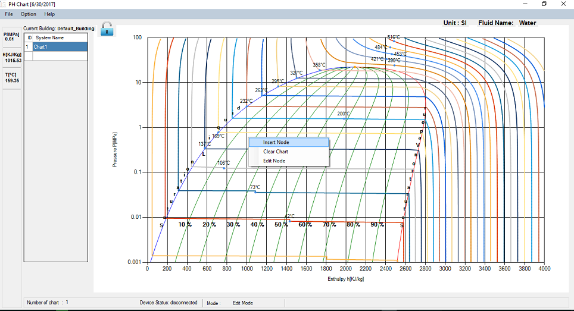
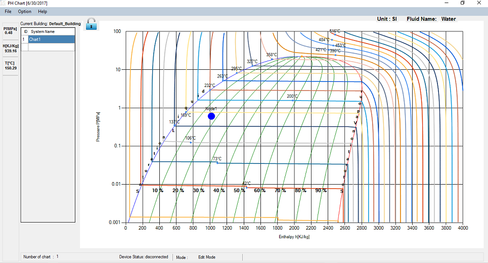

The very first step you need to be sure before making any operation Lock icon shhould be UNLOCK i.e it should be in 'Edit Mode'. If not, please click on the Edit icon.

Adding Charts

You should create a chart before adding node in blank chart. Just double click on blank table space in 'Chart Panel' and type name ('Chart1' for eg.) and after typing the name,press 'Enter' key. If you want to add next chart, select  the first one and press 'Enter' and add chart for next refirigeration system as described above. You can put as many charts as you want. You can see total number of charts in 'Status Panel'.

Adding Nodes

Right click the mouse and click 'Insert Node'. The node will have node name 'Node1' and blue color by default. If you dont know the node position, dont worry.You can change the positions and edit all other parameters later.

Likewise, you can add upto 4 nodes in the chart. To edit node property you can edit it in "Node Edit" section which will be explained later.
