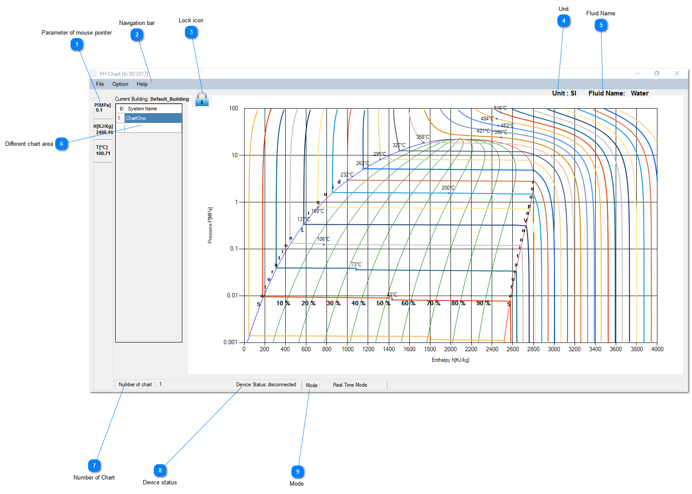

## PH chart

## Parameter of mouse pointer
  This shows the pressure(P), enthalpy(H), and temperature(T) of the current mouse move over the chart.

## Navigation bar

It contains file, option and help section.

## Lock icon

Initially the icon is locked. We need to unlock the icon to use the chart.

## Unit

Show the unit used in the application.

## Fluid Name

Show the name of the fluid for which the chart is plotted. We support different fluids such as water, ammonia , acetone, n-propane, etc.

## Different chart area

Initially the chart is blank. We need to add a chart to begin further processing.

## Number of Chart

Count the number of chart currently present in chart name area.

## Device status

Show whether the Temco device is connected or not.

## Mode

The mode of the chart. It could be either real time mode or editing mode. In real time mode data are updated from device. Editing mode is used to edit different
