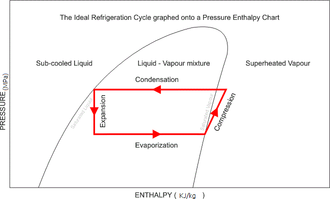

PH Diagram:

Pressure -Enthalpy(PH) diagram describes the relationship between pressure and enthalpy for a given refrigerant. The refregent could be water, ammonia, Propane.R134-a, butene,etc. Enthalpy is plotted on x-axis and pressure on y-axis. The unit of enthalpy is KJ/Kg, and of pressure is MPa.

Use :

This diagram is helpful on studying the refregration cycle. Refregration cycle has four stages :

1\. Evaporation.

2\. Compression

3\. Condensation

4\. Exapnsion

