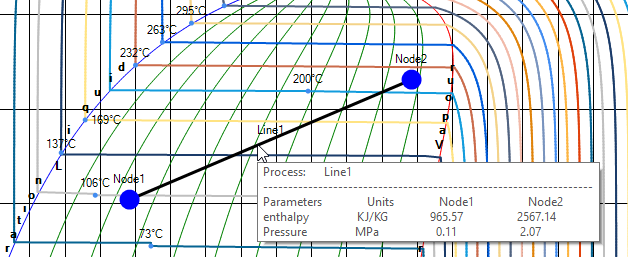
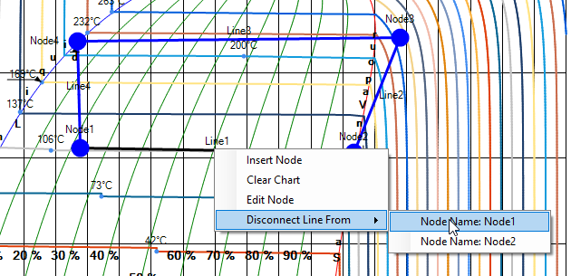
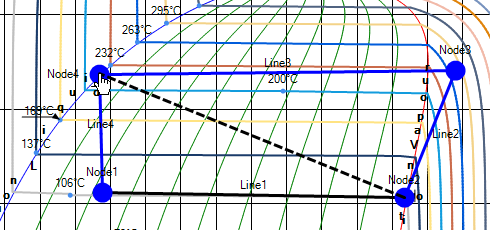
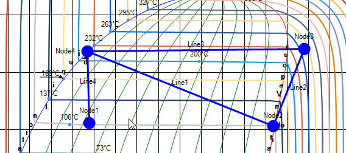

You can always disconnect process line and make new arrangement.

The process line color becomes BLACK when you point the desired process line.

Right click and choose from which node you want to disconnect the line. You can see the connecting nodes there.

Choose the desired node, move the line to another node and click to connect the line again to connect with other node.

Finally the line will be connect as:

Using this feature, you can make any desired arrangememnt.
