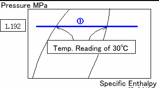
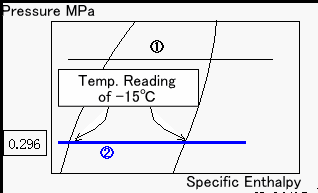
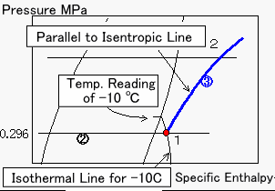
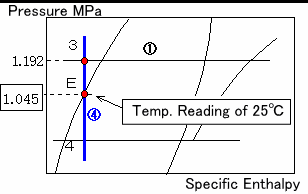
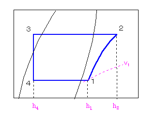

**Draw the following refrigeration cycle on a p-h diagram.**

Refrigerant

Evaporating

Temperature

Condensing

Temperature

Liquid Temperature before the Expansion Valve

Suction Gas Temperature

R22

\-15 degC

30 degC

25 degC

\-10 degC

Notice :     Conditions may be given as follows. Meanings of both are the same.

Refrigerant

Evaporating

Pressure

Condensing

Pressure

Subcool

Superheat

R22

0.296 MPa

1.192 MPa

5 degC

5 degC

**Procedure**

(1) Draw a line for a condenser

Draw a horizontal line (1) crossing both on a saturated vapor line and saturated liquid line at 30 degC. The length of the line is adjusted later. Shorter the line is, easier adjusted.

A horizontal line passing through a condensing pressure of 1.192 MPa for 30 degC is same as the above line.

(2) Draw a line for an evaporator

Draw a horizontal line (2) crossing both on a saturated vapor line and saturated liquid line at -15 degC. The length of the line is also adjusted later.

A horizontal line passing through a condensing pressure of 0.296 MPa for -15 degC is same as the above line.

(3) Draw a line for a compressor

An intersection point (Point 1) of the line for an evaporator (2) and an isothermal line for -10 degC shows a position of a suction gas to a compressor. Draw a curve (3) from Point 1 parallel to an isentropic line. An isentropic line is a curve.

(4) Draw a line through an expansion valve

Since the refrigerant is a subcooled liquid of 25 degC, draw a vertical line (4) that passes through a saturated liquid line for 25 degC (Point E). An intersection point (Point 3) of the line (4) and the line (1) shows a position before the expansion valve.

Point E obtained from a saturate pressure of 1.045 MPa for 25 degC is the same.

(5) Complete the figure

You can draw a refrigeration cycle on a  p-h diagram as above stated. Since it is not good to look at, please finish it like the following figure by erasing extra lines outside of Point 1 to 4. You can read various values from the diagram.

**Have you finished drawing a refrigeration cycle on a p-h diagram well?**

You can read out a specific volume (v1) and specific enthalpies (h1, h2, h4) from the figure.

(Answer)

A specific volume and specific enthalpies at each point

Specific volume     v11=0.08 m3/kg

Specific enthalpy     h1=403 kJ/kg, h2=438 kJ/kg, h4=230 kJ/kg
