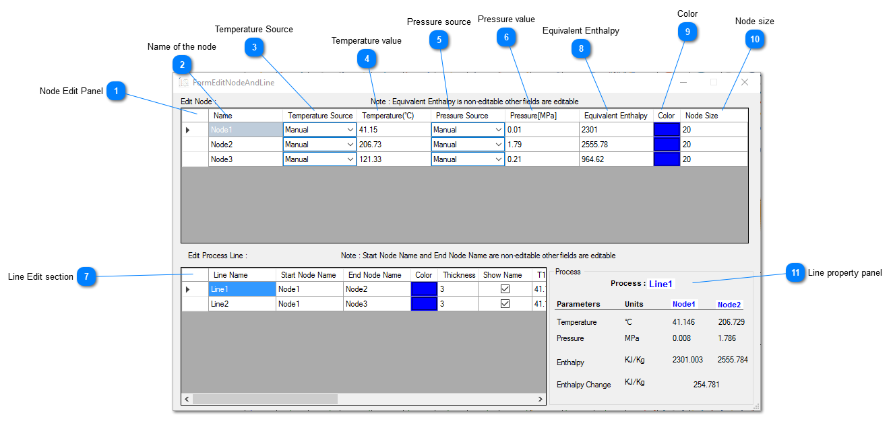
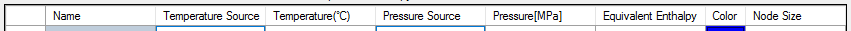

## **Node Edit Panel

**

## Name of the node

Displays the node name

## Temperature Source

Shows weather the data is from manual input or from device.

## Temperature value

Shows the value of temperature a node is representing. Unit is degree celcius.

## Pressure source

Shows whether the pressure is from manual input or from device.

## Pressure value

Shows the value of the pressure. Unit is MPa(Mega pascal)

## Line Edit section

Helps in editing different line property. We can change line size,color and also control weather we want line caption to appear or not in chart.

## Equivalent Enthalpy

Represent x asix(or enthalpy) value which in KJ/KG.

## Color

This helps to change the color of the node.

## Node size

Helps to change the size of the node.

## Line property panel

Shows the line property
