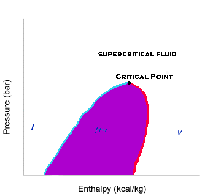

The shaded dome-like region outlines when the compound is both a mix of saturated liquid and saturated vapor. The tip of the dome marks the critical point. The area to the right of the critical point is vapor. The area to the left of the critical point is liquid. The region above is supercritical fluid.

The dome line (blue) that lies right of the critical point is the saturated vapor line. The dome line (red) that lies left of the critical point is the saturated liquid line.

