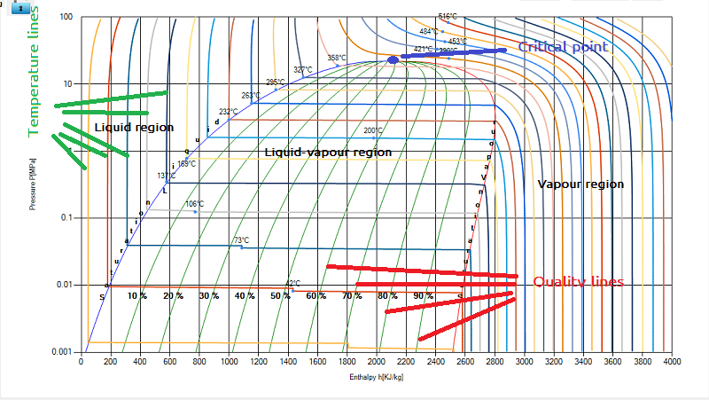

The different parameters of chart are

1\. pressure,

2\. enthalpy,

3\. temperature,

4\. Quality

Pressure : It is represented by vertical axis. Pressure is measure either in psi or MPa or other pressure unit. In this chart we use MPa as a standard unit.

Enthalpy :

It represents the head in the system. Enthalpy is represented along the horizontal axis. The unit of enthalpy is taken as KJ/Kg(Kilo joule per kg).

Temperature:

 It is represented by vertical lines in liquid and vapour section, and by horizontal lines in liquid vapour dome.

Quality :

This line exist inside the dome, and varies in terms of percentage(%).

