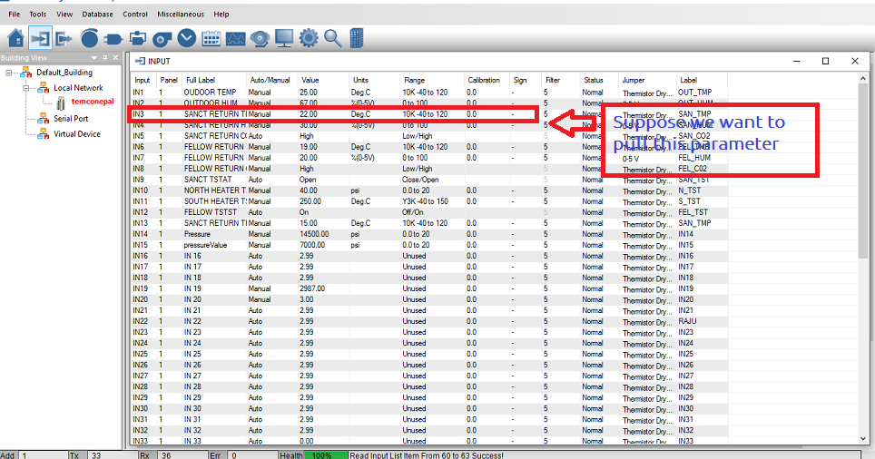
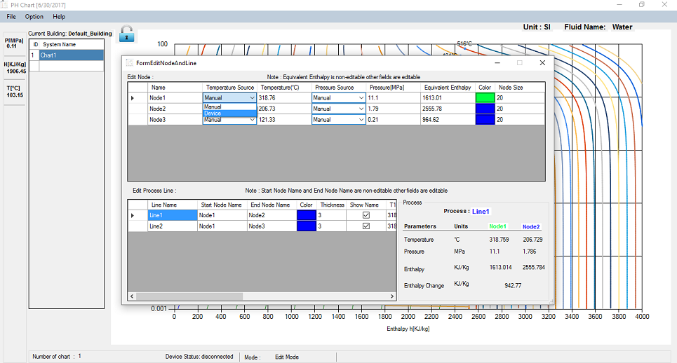
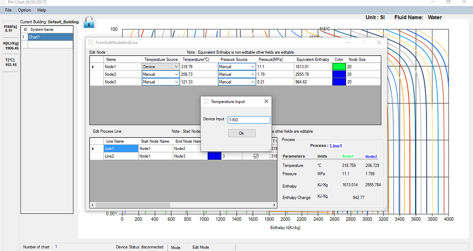
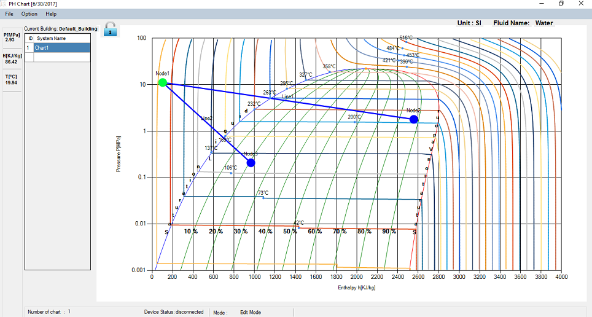

After setting nodes we can pull data from temco hardware such as T3000. Follow following steps to pull the data:

1\. Turn on T3000

2\. insert some nodes.

3\. Go to edit node

4\. Click on dropdown menu of source (either temperature or pressure which ever you want to pull the data)

5\. Click on device

6\. Input hardware detail.

7\. Click ok

Hardware detail :

If you want to pull the data from controller 1 and from input section which have index 2 in T3000 then type:

1-IN2

Likewise, for controller 2 and input 3 : 2-IN3

and so on.

Screenshots:

1\. Go to T3000 to select the parameter you want to pull.

Note: For temperature unit should be Deg.C and for Pressure unit should be psi.

2\. Go to PH application edit node section.

i) select the node you want to pull data from

II) A dialog box will appear, type the controller number, hypen and panel id.

Here, in this case : 1-IN3

Click ok and close the edit node section.

Note: Node data will be automatically updated after setting this.

