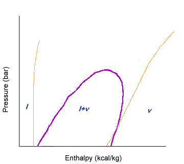

## Reading enthropy

Entropy lines are lines with a fairly steep, upward slope. Usually, these lines will have a more upward slope than volume. The lower the enthalpy, the more vertical the entropy lines become. The entropy lines don't change much when they enter the liquid-vapor dome.

