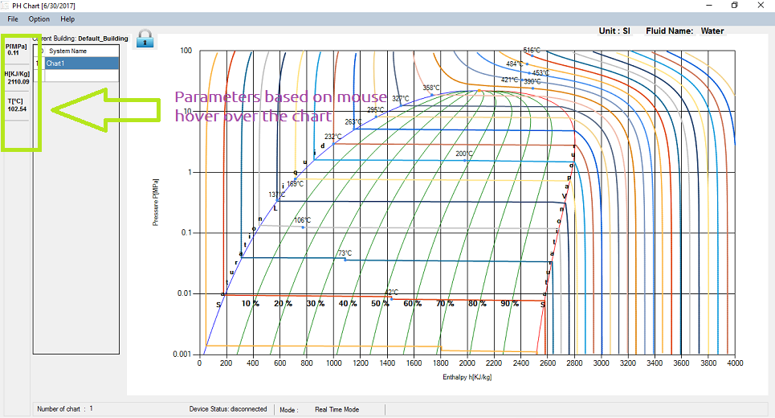

You can read all PH paraments of any pont inside the chart. You just need to hover the mouse inside the chart anad you can see all parameters in PH Parameters Panel. Please check the following screenshot:

