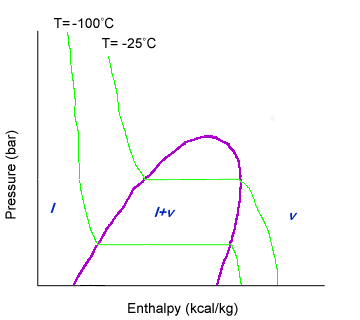

Temperature is slightly harder to read than other properties. An isotherm, or equal temperature line, has a downward slope until is hits the liquid-vapor dome. Once the line hits the liquid-vapor dome, the isotherm has no slope and is horizontal. Once the isotherm leaves the liquid-vapor dome, it has a negative slope again.

Since the isotherm is horizontal within the liquid-vapor dome, that means that the pressure is constant at the same time that temperature is constant. How can both pressure and temperature stay constant?

The compound in question is undergoing a change in state from all liquid to all gas. Heat put into the system must be used to break the intermolecular bonds between molecules. Thus, the heat does not raise the temperature. The pressure can be kept constant by varying the volume.

