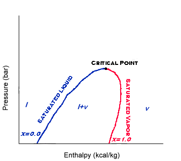
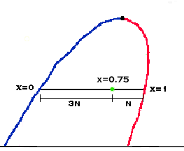
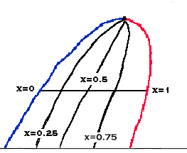

When a compound is in the liquid-vapor dome, it is often useful to know what fraction of the compound is in a saturated liquid state and what fraction is in a saturated vapor state. The term, vapor fraction, gives the fraction that is in a gaseous state. Vapor fraction is represented by the variable, x.

The line left of the critical point on the dome is the saturated liquid line. That means the vapor fraction anywhere on that line is 0. However, the line to the right on the dome is the saturated vapor line. That means the vapor fraction on that line is 1. Any point between those too lines then has a vapor fraction value between 0 and 1.

The relation between position in the dome and vapor fraction is linear. That is, a point halfway between the saturated vapor line and the saturated liquid line has a vapor fraction of 0.5. A point (see diagram) that is 3 times farther from the liquid line then the vapor line has a vapor fraction of 0.75. This kind of calculation follows the lever rule.

We can then draw a line between all points that have the same vapor fraction to give a Constant x line. Note that the saturated vapor line is a Constant x line with x=1, and a saturated liquid line is a Constant x line with x=0.

