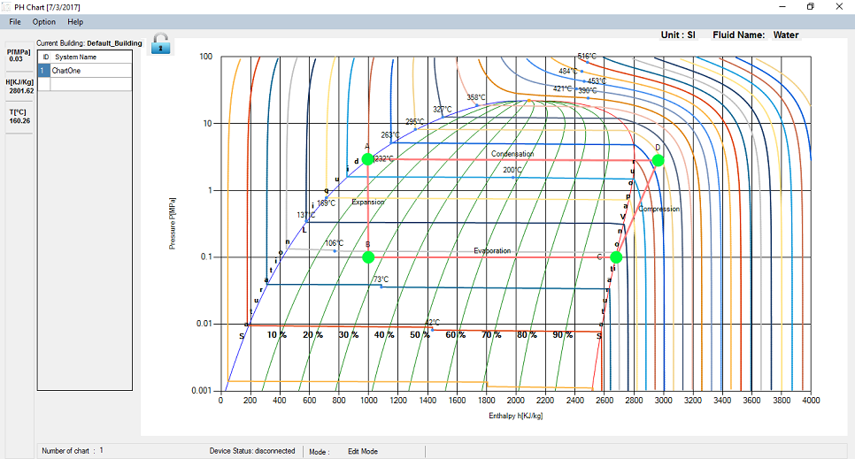
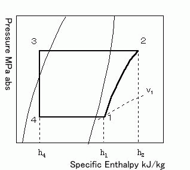

Evaporation:

The line from point B to point C denotes expansion line. In this process the enthalpy changes while the pressure remains constant.

Compression:

Line from C to D denotes the compression line.

Condensation:

Line form D to A denotes the condensation line.

Exapnsion:

Line from A to B denotes the expansion process.

Point 1 to 2: Refrigerant change in a compressor

Point 2 to 3: Refrigerant change in a condenser

Point 3 to 4: Refrigerant change through an expansion valve

Point 4 to 1: Refrigerant change in an evaporator

