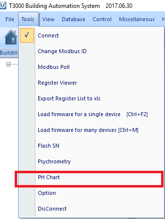
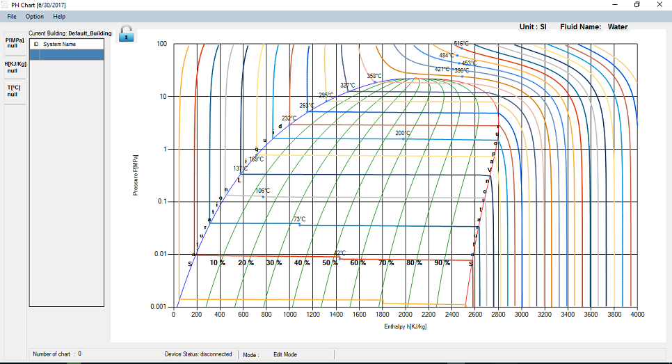

To enter the Temco PH Tool, click on 'PH Chart' under Tools in T3000 software.

PH Tool apllication will appear as :

This is a blank chart. It shows the behaviour of the building selected in T3000. Currently the selected building is 'Default\_Building'. This chart is for water.
