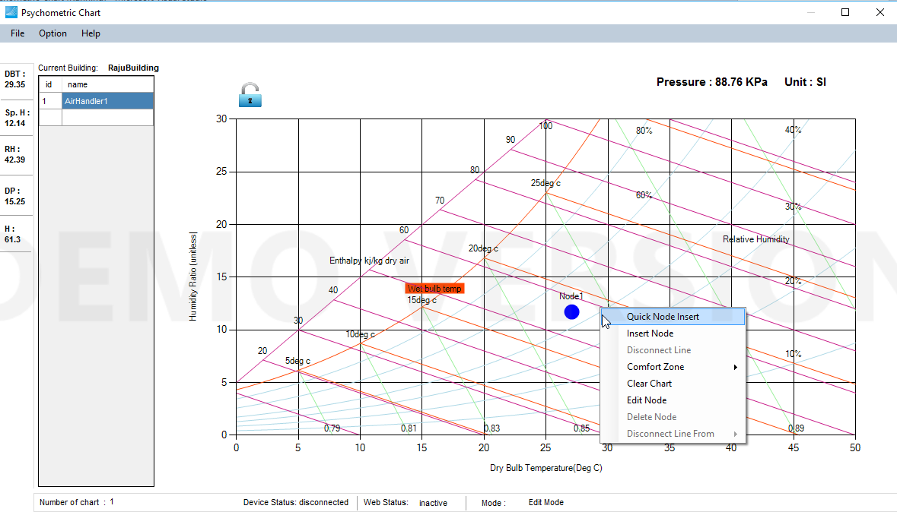
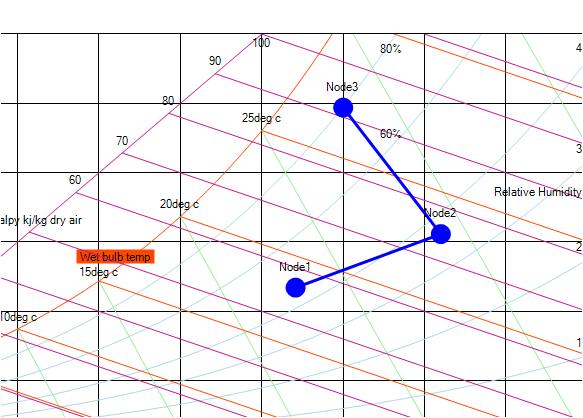

The very first step you need to be sure before making any operation Lock icon shhould be UNLOCK i.e it should be in 'Edit Mode'. If not, please click on the Edit icon.

Adding Charts

You should create an airhandler before adding node in blank chart. Just double click on blank table space in 'Air Handler Panel' and type name ('AirHandler1' for eg.) and after typing the name,press 'Enter' key. If you want to add next airhander, select  the first one and press 'Enter' and second air handler as described above. You can put as many air handlers as you want. You can see total number of air handlers in 'Status Panel'.

Adding Nodes

Right click the mouse and click 'Quick Node Insert'. The node will have node name 'Node1' and blue color by default. If you dont know the node position, dont worry.You can change the positions and edit all other parameters later.

Please note that you can always change node.

If you want to add more than one node, you simply right click and click 'Quick Node Insert' . You can add many nodes as your requirements. When you have two are more nodes, you can start seeing Process Lines connecting the susquent nodes as shown in below scrrenshot.

Please note that node parameters and position can always be changed.
