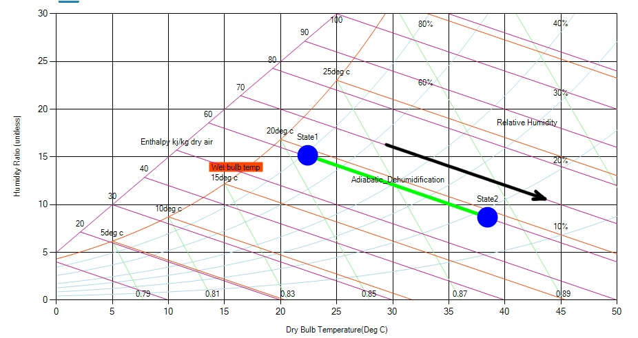

The process in which the air is passed through a chemical absorbent material (e.g., silica gel), some of the moisture is removed and the latent heat of evaporation is released. There will be an increase in sensible heat content (i.e. DBT), in the system, the state point will move down and towards the right along an enthalpy line. This process, in effect is the reverse of the previous one.

Fig: Nature of adiabatic dehumidification process in a psychrometric chart
