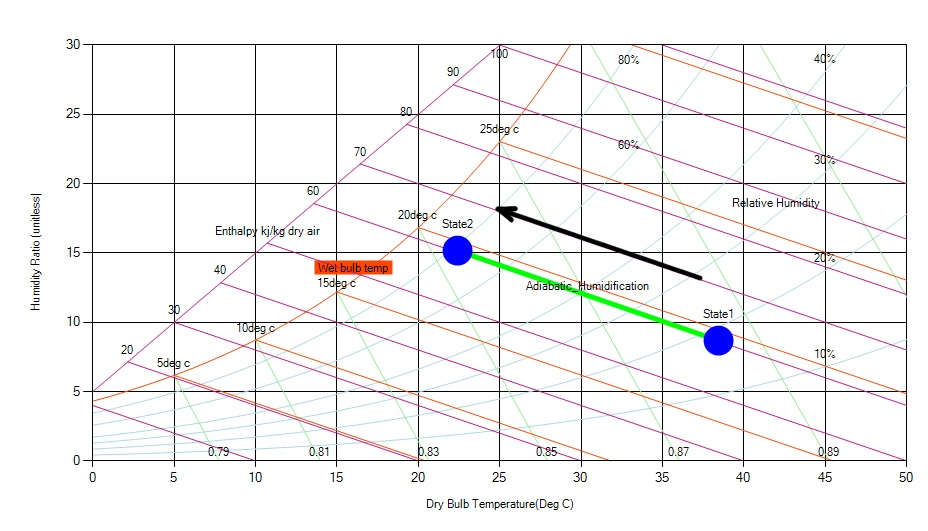

The process in which moisture is evaporated into an air volume without any heat input or removal. The latent heat of evaporation is taken from the atmosphere i.e. there will be use of DBT heat present in air. The sensible heat content (i.e. the DBT) is reduced, but the latent heat content is increased. The status point moves up and to the left, along a WBT line. This is the process involved in evaporative cooling. Note that this process increases the relative humidity. It increases only until it hits the saturation line, at which it becomes 100%. Beyond it there is no decrease in sensible temperature. This is the reason why during hot and humid months, evaporative cooling is ineffective and uncomfortable.

Fig: Nature of adiabatic humidification process in a psychrometric chart
