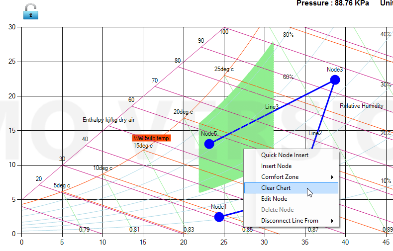
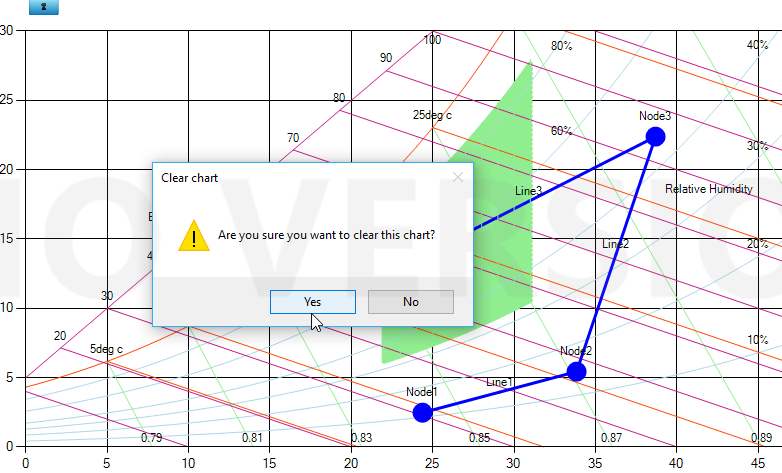
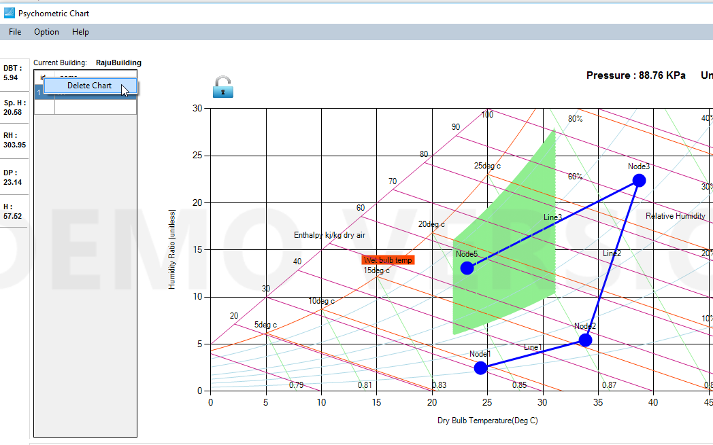

Clear chart

Right click and select 'Clear Chart' to clear all available nodes, process lines and comfort zones there in the chart. Program asks to confirm before clearing the chart.

Delete air handler

Right click on the air handler you want to delee and click delete chart. Program asks to confirm before deleting the chart.

