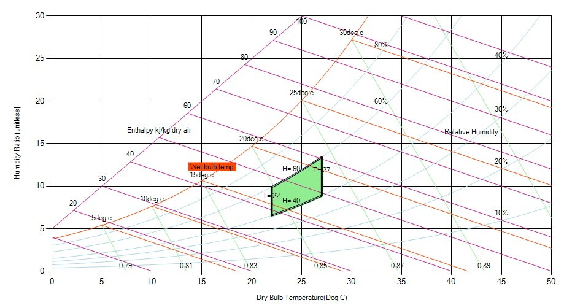

One of the major applications of the Psychrometric Chart is air conditioning, and we find that most humans feel comfortable when the temperature is between 22°C and 27°C, and the relative humidity between 40% and 60%. This defines the "comfort zone" which is shown on the Psychrometric Chart as shown below. Taking help of the chart we either heat or cool, add moisture or dehumidify as required in order to bring the air into the comfort zone.

Though there is no standard, comfort zone parameters ranges vary like people in gym, data centre, summer time, winter time etc.

Fig: Comfort zone in a psychrometric chart.
