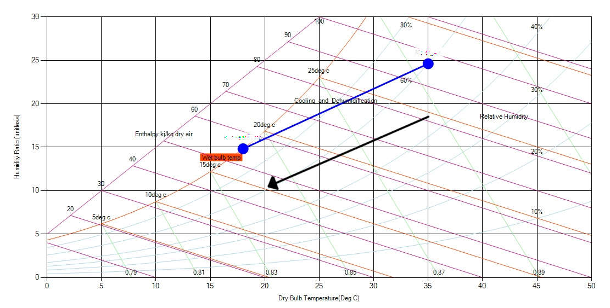

When the air comes in contact with the cooling coil that is maintained at the temperature below its dew point temperature, its DB temperature starts reducing. The process of cooling continues and at some point it reaches the value of dew point temperature of the air. At this point the water vapor within the air starts getting converted into the dew particles due to which the dew is formed on the surface of the cooling and the moisture content of the air reduces thereby reducing its humidity level. Thus when the air is cooled below its dew point temperature, there is cooling as well as dehumidification of air.

During the cooling and dehumidification process the dry bulb, wet bulb and the dew point temperature of air reduces. Similarly, the sensible heat and the latent heat of the air also reduce leading to overall reduction in the enthalpy of the air. The cooling and dehumidification process is represented by a straight angular line on the psychrometric chart. The line starts from the given value of the DB temperature and extends downwards towards left.

Fig: Nature of Cooling & Dehumidification in a pschrometric chart
