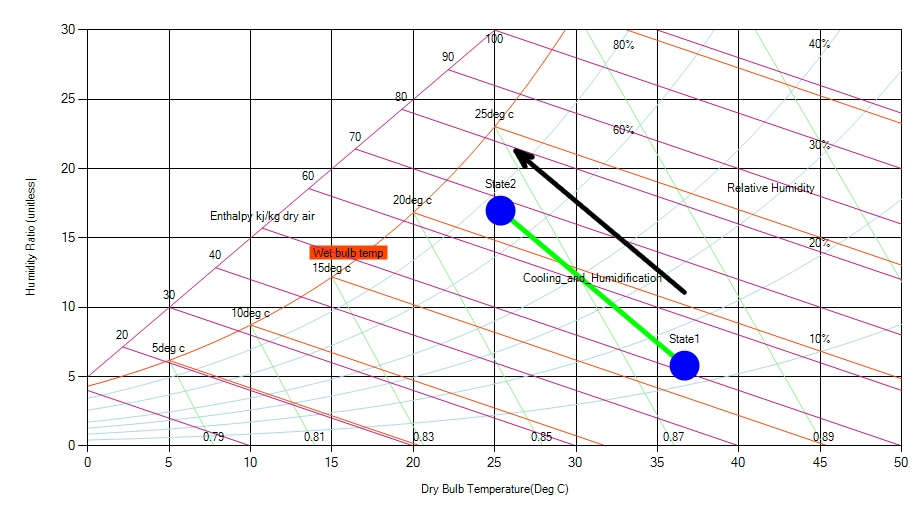

Cooling and humidification process is one of the most commonly used air conditioning application for the cooling purposes. In this process the moisture is added to the air by passing it over the stream or spray of water which is at temperature lower than the dry bulb temperature of the air. When the ordinary air passes over the stream of water, the particles of water present within the stream tend to get evaporated by giving up the heat to the stream. The evaporated water is absorbed by the air so its moisture content increases, thus the humidity increases. At the same time, since the temperature of the absorbed moisture is less than the DB bulb temperature of the air, there is reduction in the overall temperature of the air. Since the heat is released in the stream or spray of water, its temperature increases.

Cooling and humidification process is represented by an angular line on the psychrometric chart starting from the given value of the dry bulb temperature and the relative humidity and extending upwards toward left.

Fig: Nature of Cooling & Humidification in a psychrometric chart
