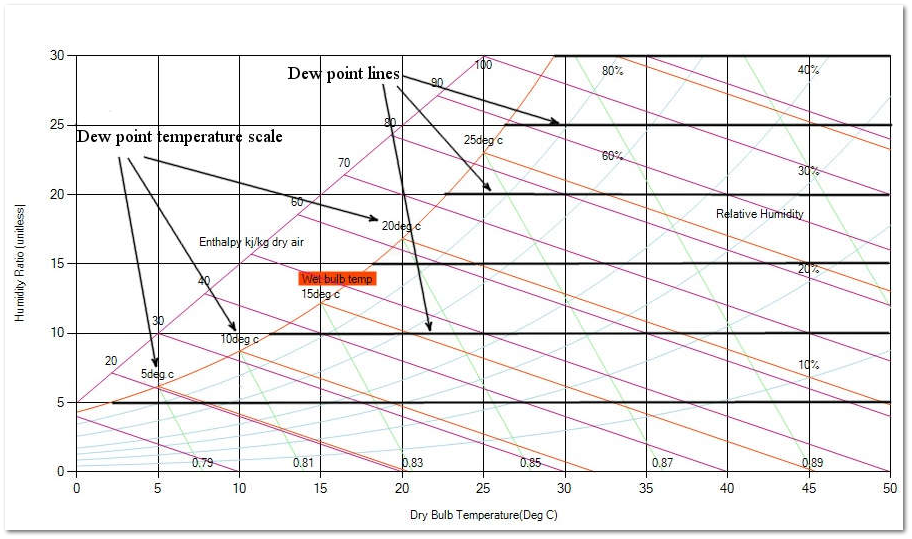

Dewpoint (DP) temperature indicates the temperature at which water will begin to condense out of moist air. Given air at a certain dry-bulb temperature and relative humidity, if the temperature is allowed to decrease, the air is no longer able to hold as much moisture. When air is cooled, the relative humidity increases until saturation is reached and condensation occurs. At this point where the dew point temperature equals the air temperature, the relative humidity is 100%. Condensation occurs on surfaces which are at or below the dewpoint temperature.

Fig: Dew-point in a psychrometric chart.

Dew-point temperature is determined by moving from a state point horizontally to the left along lines of constant humidity ratio until the upper, curved, saturation temperature boundary is reached.
