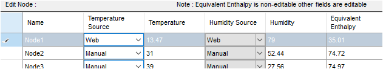
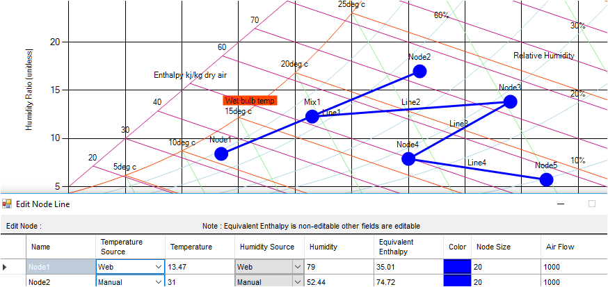
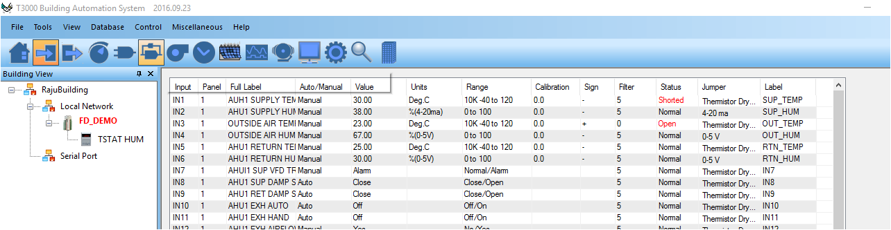
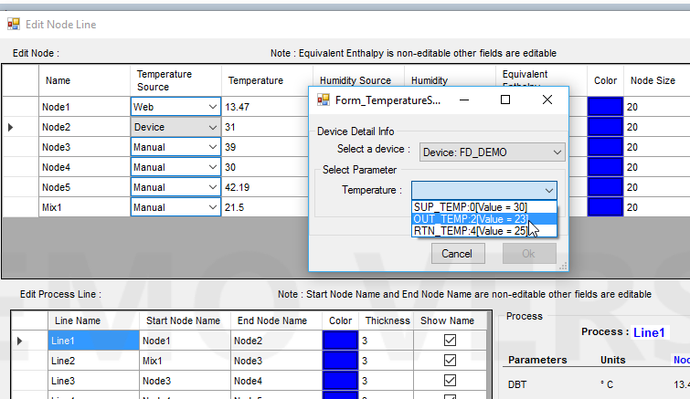
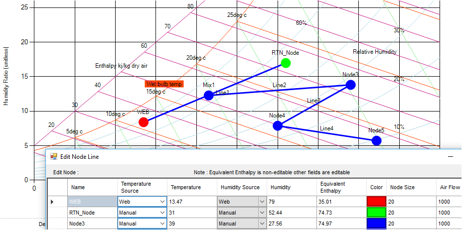

**Name**

The default NAME of node is 'Node1', 'Node2', etc... You can change NAME clicking in the NAME field.

**Temperature Source**

Initially when you simply insert the nodes, the source of temperature is  'Manual'. These values can be used for simulation purpose. You can always change the source. You will always have three options:

1. Manual

2. From web (weather station from internet)

3. From  device (T300 controller using bacnet data)

If you dont have temperature sensors available , you can always take help of  WEB to get the current outdoor temperature.

If source is 'Manual', you can edit and change Temperature value (Just double click on the vale and enter new value). Based on new value, nodes also get adjusted.

If you chhose 'Web' or 'Device', you are not allowed to edit the values.

'Web' gets data from nearest weather station based on current selected building location. Please note that you must mention country, city, street etc  while you insert new building in T3000 software. Baaed on that information, our tool finds nearest weather station and get the data (for example in below screenshot: temperature =13.47 degree centigratee from web).

And node ('Node1') gets repositioned in new data.

Before entering into the 'Device' option for source selection, please have a look on the screenshot of current T3000 staus here.

If you choose and click 'Device' option for source, you willl get option to chhose variables from current input and output in T3000 controller.

The screenshot example shows that you are getting Temperature from 'FD\_DEMO' controller whose label is 'OUT\_TEMP' (i.e it is from IN3)' and value is 23 degree centigrade. It only lists the temperature parameters.

**Humidity Source**

Simlarly, we can choose the source for humidity .

You can change the node name . Lets change the 'Node1' to 'WEB' and 'Node2' to 'OUT\_Node' and also the colors. As you change in grid, the effect can be seen in the chart instantly.

If any values in T3000 gets changed, the node position also gets changed if that node sources are from T3000 controller (See the below screenshot). The refresh rate is 10 second for each node.

If you move the node from one position to another and if node source is either Web or Device, it will again go to its original position automatically. If node source is Manual, it will remain to the new position if repositioned.

What happens if controller or internet goes offline?

\>> It shows the last scanned value just before offline. Once device necomes online, it starts updating again.

Enthalpy is auto calculated based on available temperature, humidity and pressure.

Show Text

You can select which parameter you want to show in chart . If you choose 'Name' there, 'WEB' will be displayed on the chart. Please see above screenshot.

Node Size

You can increase or decrease the node size by manually entering the new size. The default NODE SIZE is 20.
