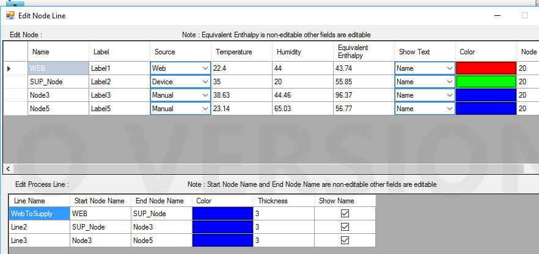

The defalt Process line name is 'Line1', 'Line2', etc..

You can always change Process Line name. You can tick or untick on 'Show Name' to show or hide the process name in chart. By default, you can see the Process Line name. Similarly, you can also change the color and thickness of process line.

