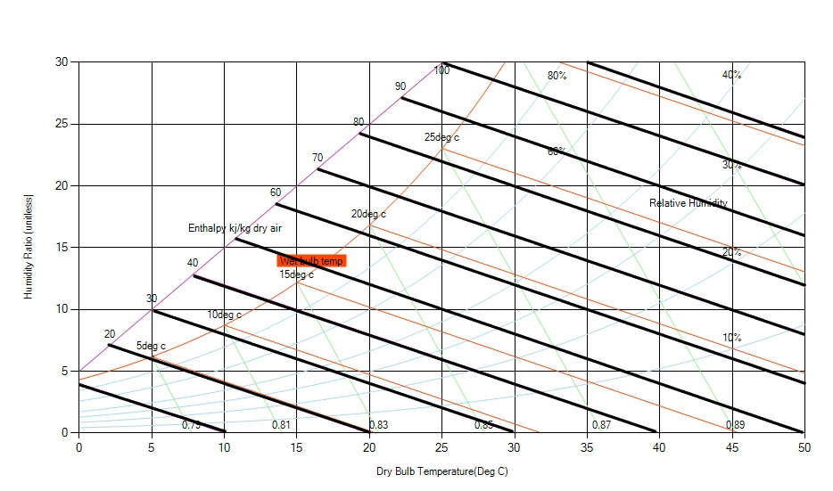

[When we talk of **Enthalpy** of air we are referring to the amount of energy stored in nthe air. Enthalpyy](https://en.wikipedia.org/wiki/Enthalpy) is a thermodynamic quantity equivalent to the total heat (energy) content of a system/moist air. It is expressed in  kJ/Kg and represents the heat energy due to temperature and moisture in the air. When we talk of the enthalpy of air we are referring to the amount of energy stored in the air. The amount of energy stored in a gas such as air is simple to understand, hotter gas means proportionally more energy content. Lines of constant enthalpy run diagonally downward from left to right across the chart. Lines of constant enthalpy and constant wet-bulb are almost parallel but values are read off separate scales. Less accurate psychrometric charts sometime use same lines for wetbulb temperature and enthalpy.

Fig: Constant Enthalpy lines on a psychrometric chart
