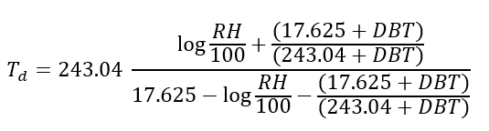
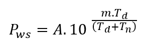
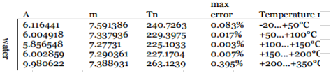
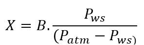
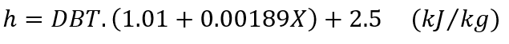
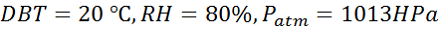
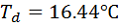
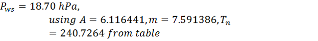
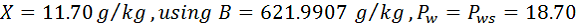
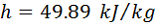

Enthalpy can be calculated from known Dry Bulb Temperature (DBT), Relative Humidity (RH) and Atmospheric Pressure. Steps to determine enthalpy are listed below:

 **1\. Calculate Dew point from DBT, RH and atmospheric pressure**

             

        where

Td=  Dew point temperature in degree centigrate

LN = Natural logarithm

RH= Relative HUmidity in percent

DBT= Dry Bulb Temperature

Atmosphere = Atmospheric pressure, \[Hpa\]

**2.  Calculate Water Vapor Saturation Pressure (Pws) from the dew point temperature**

where ,

Pws = Partial Pressure of water at saturation at given temperature, \[hPa\]

Td = Dewpoint temperature

A, m, Tn =  curve fitting constants which are obtained as below

**3\. Calculate the mixing ratio (X), mass of water to mass of air**

where.

X= mixing ration, \[g/Kg\]

Pws = Partial Pressure of water at saturation at given temperature, \[hPa\]

Patm = Atmospheric pressure, \[hPa\]

B = Molecular mass of water over the molecular weight of gas x 1000 , 621.9907 for air \[g/kg\]

**4\. Calculate the enthalpy**

    

Note: TBD: Below zero degrees, use different formula for dewpoint.

Example

Let's see one example here. Lets assume your outdoor environment has 20 degree centigrate with 80% RH. Consider standard pressure 1013 Hpa.  We will calculate all other parameters and enthalpy finally.

So, given:

     

Using above mentioned formula, we will have following:

 

