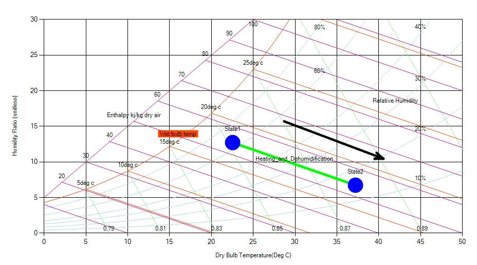

The process in which the air is heated and at the same time moisture is removed from it is called as heating and dehumidification process. This process is obtained by passing the air over certain chemicals like alumina and molecular sieves. These elements have inherent properties due to which they keep on releasing the heat and also have the tendency to absorb the moisture. These are called as the hygroscopic chemicals.

In actual practice the hygroscopic elements are enclosed in the large vessel and the high pressure air is passed inside the vessel through one opening. When the air comes in contact with the chemicals the moisture from the air is absorbed and since the chemicals emit heat, the DB temperature of the air increases. The hot and dehumidified air comes out from the vessel through other opening in the vessel. The inlet and outlet openings of the vessel are controlled by the valve.

The heating and humidification process is commonly used for reducing the dew point temperature of air. There are number of automatic valves in the chemical plants that are operated by the compressed air at high pressure. If the dew point temperature of this air is high, there are chances of formation of dew inside the valves which can lead to their corrosion and also faulty their operation. Thus it is very important that the air passing to such automatic valves have very low dew point temperature. The heating and dehumidification process by using hygroscopic materials is used often in the air drying units.

During the heating and dehumidification process dry bulb temperature of the air increases while its dew point and wet bulb temperature reduces. On the psychrometric chart, this process is represented by a straight angular line starting from the given DB temperature conditions and extending downwards towards right to the final DB temperature conditions.

Fig: Nature of Heating & Dehumidification process in a psychrometric chart
