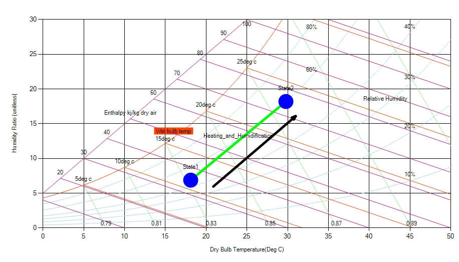

In heating and humidification psychrometric process of the air, the dry bulb temperature as well as the humidity of the air increases. The heating and humidification process is carried out by passing the air over spray of water, which is maintained at temperature higher than the dry bulb temperature of air or by mixing air and the steam. Comparing to cooling and humidification heating and humidification is just mixing of air with water content at higher temperature than that of air.

When the ordinary air is passed over the spray of water maintained at temperature higher than the dry bulb temperature of the air, the moisture particles from the spray tend to get evaporated and get absorbed in the air due to which the moisture content of the air increase. At the same time, since the temperature of the moisture is greater than the dry bulb temperature of the air, there is overall increase in its temperature.

During heating and humidification process the dry bulb, wet bulb, and dew point temperature of the air increases along with its relative humidity. The heating and humidification process is represented on the psychrometric chart by an angular line that starts from the given value of the dry bulb temperature and extends upwards towards right (see the figure below).

Fig: Nature of Heating & Humidification in a psychrometric chart
