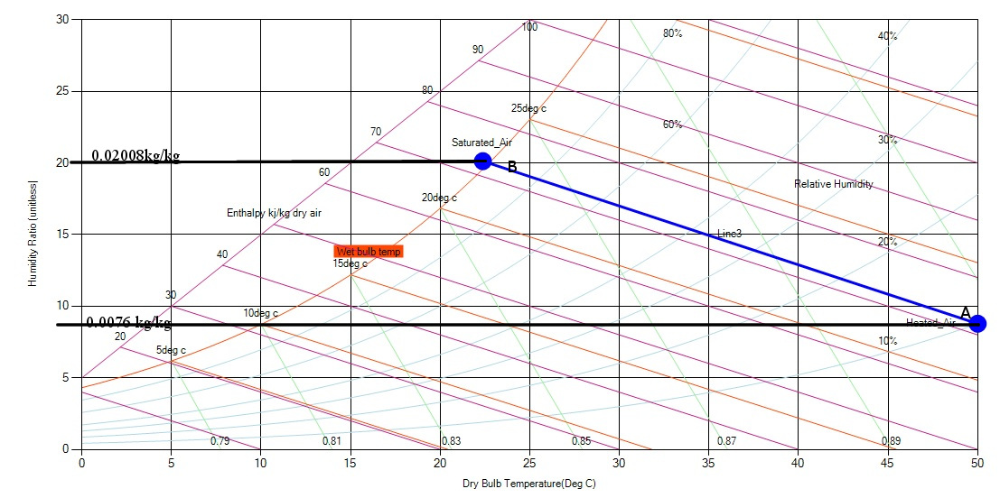
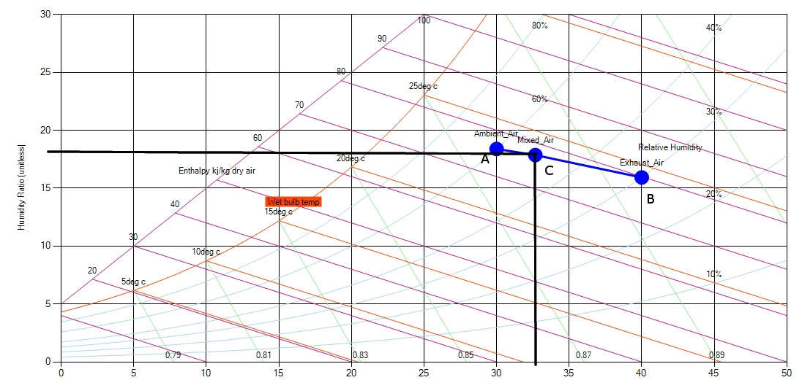
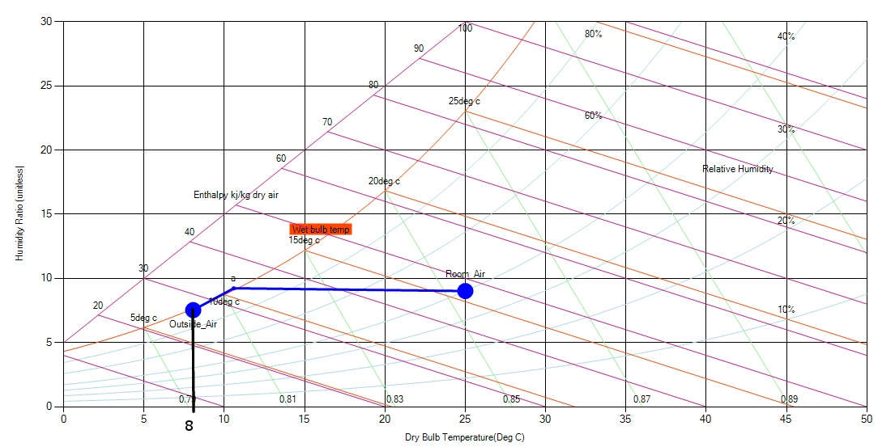

**Example 1**

Heated air at 50 C and 10% relative humidity is used to dry rice in a bin dryer. The air exits the bin under saturated conditions. Determine the amount of water removed per kg of dry air.

**Solution**

- Locate point A on the psychrometric chart, as shown in Figure. Read humidity ratio  0.0076 kg water/kg dry air.

- Follow the constant enthalpy line to the saturation curve, point B.

- At point B, read the humidity ratio  0.02 kg water/kg dry air.

- The amount of moisture removed from rice  0.02 – 0.0076 = 0.0124 kg water/kg dry air

    **Example 2**

    In efforts to conserve energy, a food dryer is being modified to reuse part of the exhaust air along with ambient air. The exhaust air flow of 10 m3/s at 400C and 30% relative humidity is mixed with 20 m3/s of ambient air at 300C and 60% relative humidity. Using the psychrometric chart, determine: the dry bulb temperature and humidity ratio of the mixed air.

**Solution**

Let us draw plot the points and follow the steps given below the figure:

- From the given data, locate the state points A and B, identifying the exit and ambient air as shown on the skeleton chart

- Join points A and B with a straight line.

- The division of line AB is done according to the relative influence of the particular air mass. Since the mixed air contains 2 parts ambient air and 1part    exhaust air, line AB is divided in 1:2 proportion to locate point C. Thus, the shorter length of line AC corresponds to larger air mass.

- The mixed air, represented by point C, will have a dry bulb temperature of 32.60C and a humidity ratio of 0.018 kg water/kg dry air.

    **Example 3**

    Assume that the outside air temperature is 8°C. If the air in a room is at 25°C with a relative humidity 40%, use the psychrometric chart to determine if the windows of that room which are in contact with the outside will become foggy.

    **Solution:**

    

    The air in contact with the windows will become colder until the dew point is reached. Notice that under the conditions of 25°C and 40% relative humidity the dew point temperature is slightly higher than 10°C, At that point the water vapor condenses as the temperature approaches 8°C along the saturation line, and the windows will become foggy.
