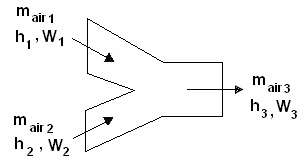
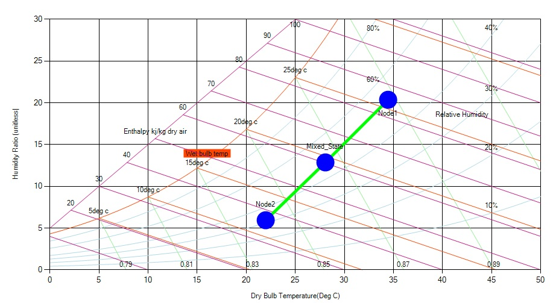

When two streams of air with different properties and flow rates are mixed, the properties of the resulting mixture (enthalpy, dry bulb temperature and saturation ratio) can be determined by simple proportional mass and energy balances.

When air streams are mixing the properties of the resulting stream can be determined by mass balances or graphically on the psychrometric chart. In most cases, heat loss from the system is negligible and the system can be modeled at adiabatic.

Multiple air mixing from different ducts, are normally performed in central air conditioners. The most common mixing, is between re-circulated air, and fresh air. Fresh air and re-circulated air mixing is very important in maintaining low operating cost of an air conditioner.

If two air streams are mixed, having:

- Mass flow rates **m1** and **m2**,

- dry bulb temperatures **t1** and **t2**,

- enthalpies **H1** and **H2**,

The result will be:

**m1t1 + m2t2 = \[m1 + m2\] t3,**

**m1H1 + m2H2 = \[m1 + m2\]H3**

Therefore:

**t3 = (m1t1 + m2t2) / (m1 + m2)**

**H3 = (m1H1 + m2H2) / (m1 + m2)**
