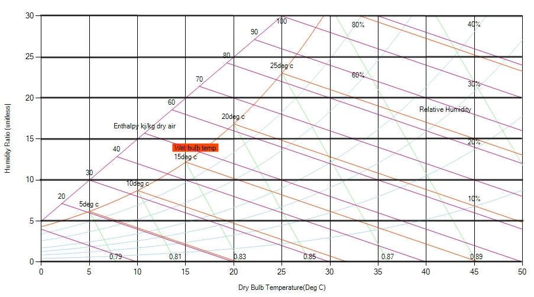

[Moisture content](https://en.wikipedia.org/wiki/Water_content) (or Humidity ratio) of moist air is the weight of the water contained in the air per unit of dry air. The humidity ratio of moist air can be expressed with the mass of water vapor in the humid air - to the mass of dry air, or by the partial pressure of vapor in the air - to the partial pressure of the dry air. Humidity ratio is found on the vertical, y-axis with lines of constant humidity ratio running horizontally across the chart.

Fig: Humidity ratio curve on a psychrometric chart
