This is strong part of our tool. We can see and edit node and process line properties. To see the node grid view, right click on the chart and 'Edit Node'  as shown below:

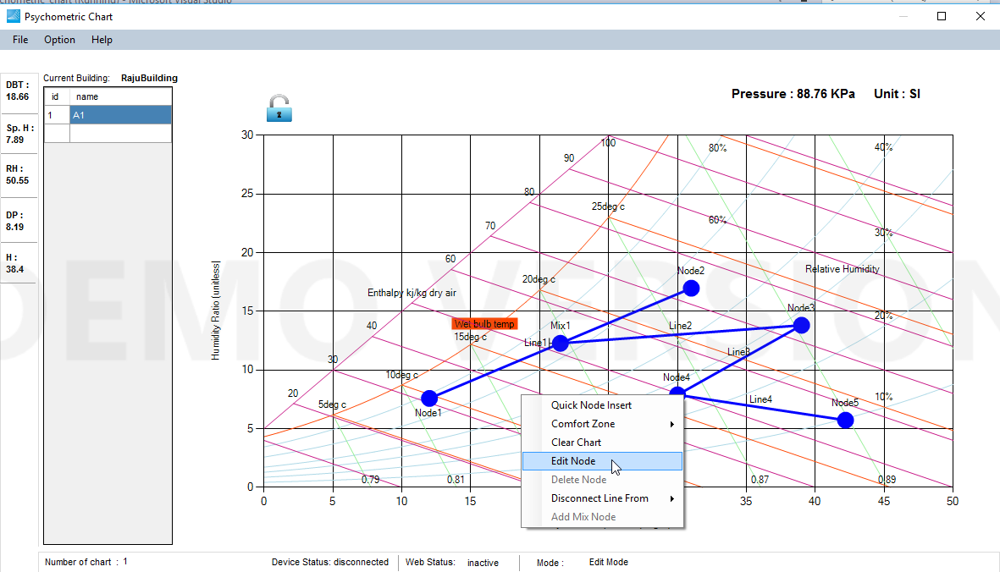

Once you click, you will see the following grid view pop up.

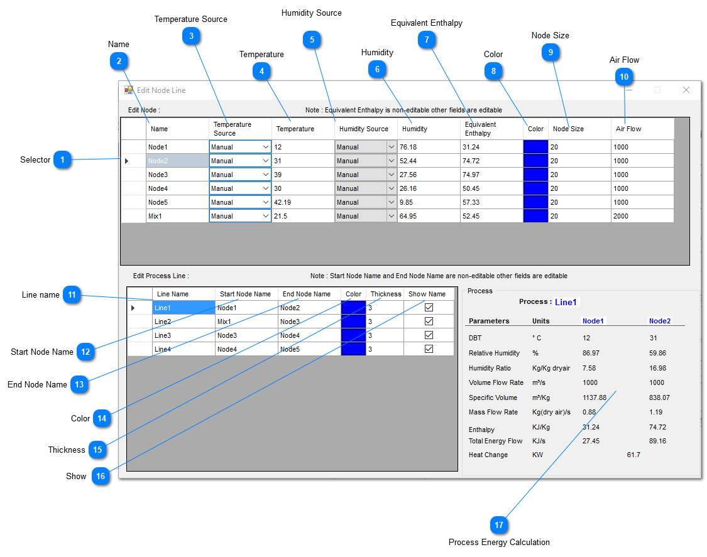

## Selector

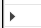

Node Selector

## Name

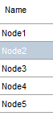

It shows Node name

## Temperature Source

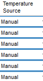

It shows the source of temperature data. It may be from T3000(device) or nearest weather station (Web) or simulated (Manual).

## Temperature

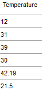

It shows the temperature value.

## Humidity Source

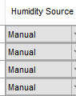

It shows the source of humidity data. It may be from T3000(device) or nearest weather station (Web) or simulated (Manual).

## Humidity

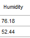

It shows the temperature value.

## Equivalent Enthalpy

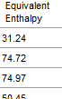

It shows the equivalent enthalpy (calculted from Temperature and Humidity)

## Color

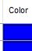

It shows the node color.

## Node Size

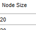

It shows the node size.

## Air Flow

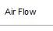

It shows the Air flow value.

## Line name

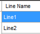

It shows the process line name connecting two nodes.

## Start Node Name

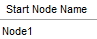

It shows the name of Starting Node of the particular process line.

## End Node Name

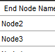

It shows the name of Ending Node of the particular process line.

## Color

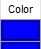

It shows the color of process line.

## Thickness

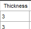

It shows the thickness of process line in chart.

## Show

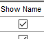

User has option to show the line name or not. If user doesnot want to show Process Line name, he/she can untick.

## Process Energy Calculation

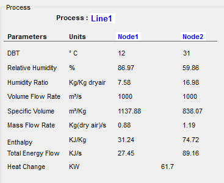

This portion shows different energy calculation of the selected process line.
