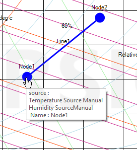

If you want to change the node position, just hover mouse over the node , click it and you can reposition anywhere inside the chart and at the end click to release the node at the new position, Below screenshots show the reposition of Node1.

When you hover the node, you can see node properties like source,name , label etc.

**Horizontal movement (Constant Humidity Ratio)**

If you drag the node pressing the 'SHIFT; key, the node only moves horizontally (Humidity Ratio remains same)

**Vertical movement (Constant DBT)**

If you drag the node pressing the 'ALT' key, the node only moves vertically (Dry Bulb Temperature remains same)
