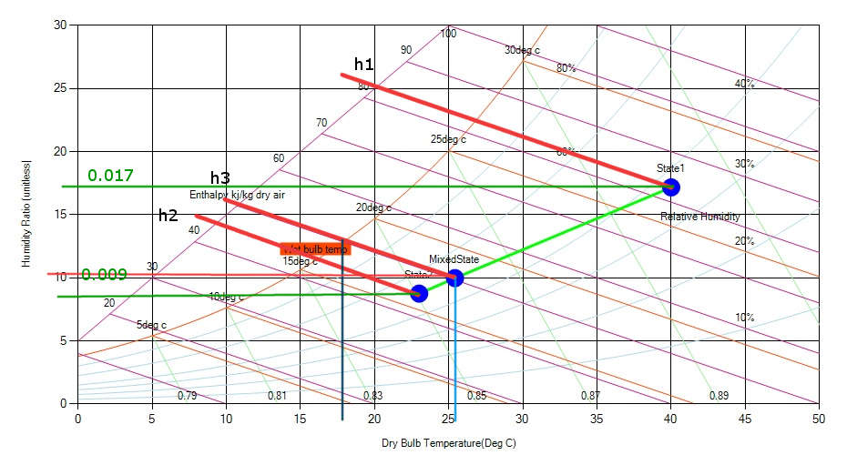

**Example:**

The makeup air at rate of 100 m3/min from the environment having tdb = 40°C and twb = 27°C is mixed with 600 m3/min of return air from the conditioned space having state Tdb = 23°C and relative humidity 50%. Compute dry and wet-bulb temperatures and specific humidity of the mixture.

**Solution:**

With the help of chart,

At state 1

Specific vol= 0.913 cu m / kg

Sp humidity= 0.017 kg/ kg

h1= 84 KJ/Kg-K

m1=100/ 0.913 kg/min

At state 2

Specific vol= 0.852 cu m / kg

Sp humidity= 0.009 kg/ kg

h2= 45 KJ/Kg-K

m2=600/0.852 kg/min

For mixing, we will have

m1\*h1+m2\*h2=(m1+m2)\*h3

109\*84+705\*45=(109+705)\*h3

h3=50 kJ/Kg-K

Locate mixed state point

DBT at mixed state point= 26 degree C

Specific humidity at mixed state point  =0.0102 Kg/ Kg of dry air

WBT=18 degree C

Note: (mixed state point can also be located by dividing the line State 1- State 2 in m1/m2 ratio)
