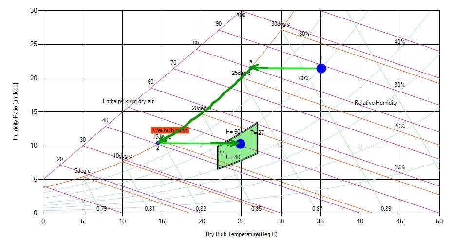
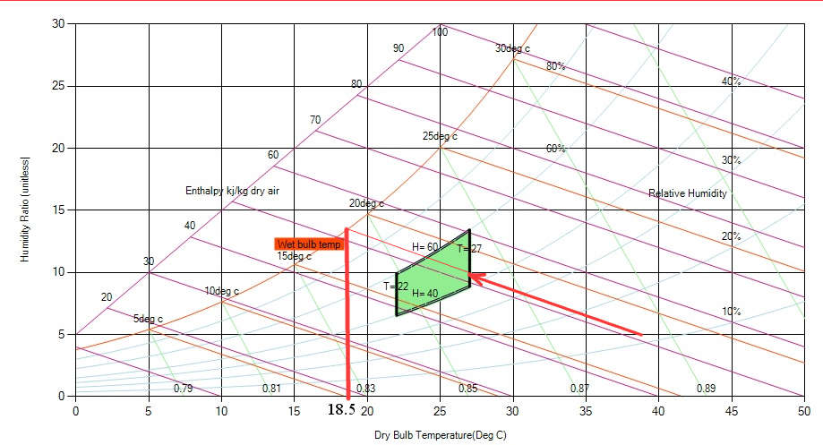

**Example**

Outside air at 35°C and 60% relative humidity is to be conditioned by cooling and heating so as to bring the air to within the "comfort zone". Using the Psychrometric Chart neatly plot the required air conditioning process and estimate (a) the amount of moisture removed, (b) the heat removed(1)-(2), and (c) the amount of heat added (2)-(3).

**Solution:**

Let us analysis with the chart and the figure below.

For shifting current region to the comfort zone let us cool the air (sensible cooling) till saturation occurs. Upon cooling when the temperature reaches to 150 C let us supply heat on air (sensible heating)  to reach the comfort zone. After plotting all the states we can find the psychrometric parameters.

(a) The amount of moisture removed (ΔHR) = 11.5g-H2O/kg-dry-air

From the enthalpy scale upon states (1)-(2), we get

 (b) the heat removed ,             qcool = 48kJ/kg-dry-air

From the enthalpy scale upon states (2)-(3), we get

 (c) the amount of heat added ,  qheat = 10kJ/kg-dry-air.

**Example**

Hot dry air at 40°C and 10% relative humidity passes through an evaporative cooler. Water is added as the air passes through a series of wicks and the mixture exits at 27°C. Using the psychrometric chart determine (a) the outlet relative humidity, (b) the amount of water added , and (c) the lowest temperature that could be realized.

**Solution:**

As in the question, lets plot initial point.

This is the case of cooling and humidification, final temperature of the mixture is 270C and enthalpy is constant, thus we can locate state 2 in the chart as above. Now with respect to the states (1) - (2) and points  (1) and (2) we can get the results as :

(a) the outlet relative humidity  = 45%,

(b) the amount of water added  = 5.4g-H2O/kg-dry-air

(c) the lowest temperature that could be realized  = 18.5°C
