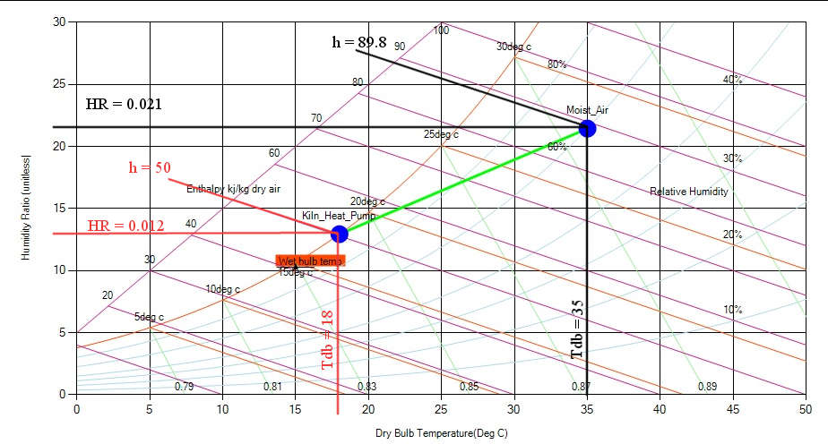

Moist air at 35°C dry bulb temperature and 60% relative humidity enters the cooling coil of a dehumidification kiln heat pump system and is cooled to a temperature of 18°C. If the drying rate of 6 m3 of red oak lumber is 4 kg/hour, determine the W of refrigeration required.

**Solution:**

Following the steps used in the previous example of sensible heating we can get the general parameters.

**Now:**

ΔHR = 0.021-0.012

         = 0.009 kg water / kg dry air

Wa  = drying rate / ΔHR

        =  (4 kg water/h) /0.009

        = 444.44 kg dry air / h

Δh = (89.8 – 50) kJ/kg dry air

                  = 39.8 kJ/kg dry air

q  = (Δh)(Wa)

                = \[39.8 x (kJ/ kg dry air)\] \[444.44 x (kg dry air/ h)\]

   =17688.712 (kJ/h)

                = 4913.531111W

   = 4.913KW
