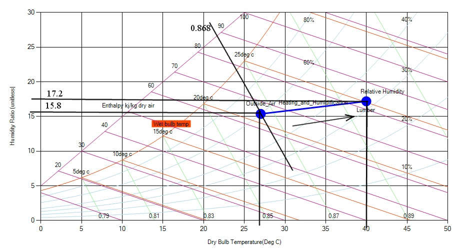

Two and a half cubic meters of lumber is being dried at 40°C dry bulb temperature and 25°C wet bulb temperature. The drying rate of the lumber is 12.5kg of water per hour. If outside air is at 27°C dry bulb temperature and 60% relative humidity, how much outside air is needed per minute to carry away the evaporated moisture?

**Solution:**

Following the steps used in the previous example of sensible heating we can get the general parameters.

**Now,**

Humidity Ratio difference (ΔHR) = (17.2 – 15.8) g water / kg dry air

\= 1.4 g water / kg dry air

\= 0.00014  kg water / kg dry air

water added (wa1) = drying rate/ΔHR

\= (12.5 kg/hour)/(0.00014 kg water / kg dry air)

\= 89285.71 kg dry air/hour

VF1=(wa1)(v1)

\=(89285.71 kg dry air/hour)(0.868 m3/kg dry air)

\= 102863.72 m3/hour

\= 1714.39 m3/minute

Thus, it requires 1714.39 m3/minute
