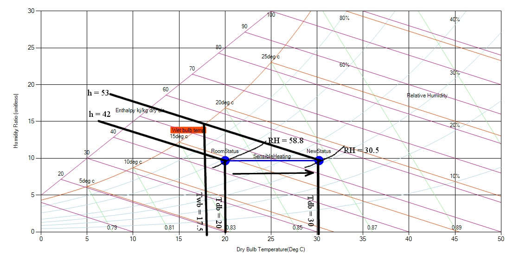

A room has a temperature of 200 C and the relative humidity of 58.8%. Determine wet bulb temperature and relative humidity of the roof after raising the temperature of the room by 100 C.

**Solution:**

As in the graph below, all the red lines correspond to the initial psychometric properties. The blue lines corresponds to the obtained result after sensible heating by 100 C. Thus after heating, parameters change as:

- Wet-bulb Temperature (Twb) = 17.50 C

- Relative Humidity (R.H.) = 30.5%

- Enthalpy (h) = 53.0 kJ/kg

Fig: Results obtained using the chart for sensible heating

**Steps :**

- Draw straight horizontal lines to the left till the desired temperature level is reached and mark the end point.

- Draw the vertical line parallel to wet bulb temperature line intersecting the marked point.

- Now measure the point's location wit respect to all the parameters and note them.

    **Note: Sensible cooling is opposite to sensible heating. It is just decrease of temperature instead of increasing as in sensible heating.**
