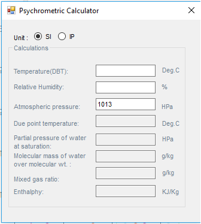
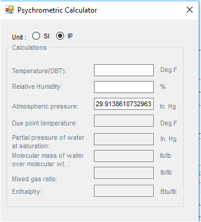

This calculator helps to find all psychrometric parameters. The defult pressure is 1013 HPa. User can enter Temperature(DBT), Relative Humidity and Atmospheric Pressure.

User can chose either SI or IP Unit system.

