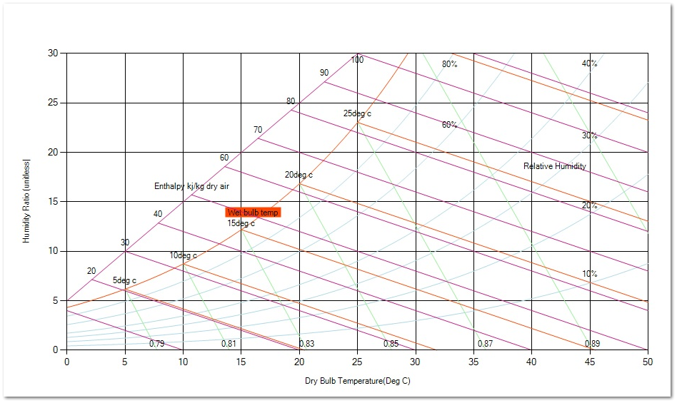

**Psychrometry OR Psychometric Chart ?? Getting trouble hmm?** The pronunciation goes like this, **p-sai-khro-metric**

Ok, one final practice of the pronunciation: **Psychrometry**. “cool”

[Psychrometrics](https://en.wikipedia.org/wiki/Psychrometrics) is the field of engineering concerned with the determination of physical and thermodynamic properties of gas-vapor mixtures. It explains various properties of air, method of controlling its temperature and moisture content or humidity and its effect on various materials and human beings. Psychrometry is an impressive word which is defined as the measurement of the moisture content of air. In broader terms it is the science and practices associated with atmospheric air mixtures, their control, and the effect on materials and human comfort. This can be accomplished through use of psychrometric tables or a psychrometric chart. The tables are somewhat more accurate, but the chart is accurate enough for all practical purposes and is much easier to use.

The psychrometric chart1 is a graphic representation of the relationship between air temperature and humidity. It helps to describe climate data and human thermal comfort conditions.

Fig : Sample psychrometric chart

Air comprises approximately 78% nitrogen, 21% oxygen, and 1% other gases. But air is never dry, even in a desert. Two-thirds of the earth’s surface is covered with water and this, along with other surface water and rain, maintain low pressure water vapor to be suspended in the air making up part of the 1% of other gases.

Any psychrometric chart is valid at a certain pressure of air. The pressure of air is related to the height above (or below) sea level.

1: Service Application Manual, THE PSYCHROMETRIC CHART AND ITS USE, SAM Chapter 630-16 Section 3A.
