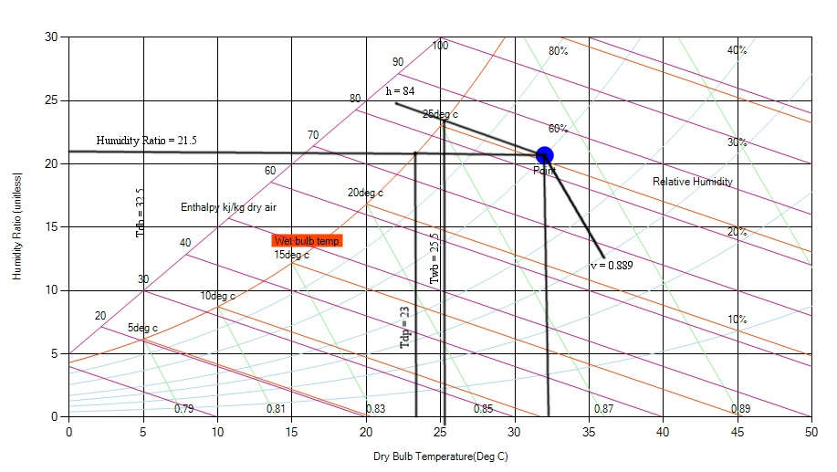

Lets start with one example to locate a point in Psychrometric chart and read other remaining psychrmetric parameters.

**Example 1**

Assume that the outside air temperature is 32°C with a relative humidity 60%. Use the psychrometric chart to determine the specific humidity, the enthalpy (h), the wet-bulb temperature (Twb), the dew-point temperature (Tdp), and the specific volume of the dry air (v). Indicate all the values determined on the chart.

**Solution:**

First, we need to locate the given point in chart. Since outside air temperature (DBT) is 32°C with a relative humidity (RH) 60%, we need to follow the Dry Bulb Temperature (DBT) horizontal line and follow the Relative Humidity (RH) curve.

After locating the given point, we need to read other parameters from chart as explained in previous sections.

From the chart, we can see following:

- Humidity ratio = 21.5

- Enthalpy (h) = 84 kJ/kg-air

- Wet-bulb temperature (Twb) = 25.5°C

- Dew-point temperature (Tdp) = 23°C

- Specific volume of the dry air (v) = 0.889m3/kg

Please note that this chart is at 0.8759 atm (88.76 Kpa) total pressure. If we have different atmospheric pressure, the change occurs in the chart and parameters as well.
