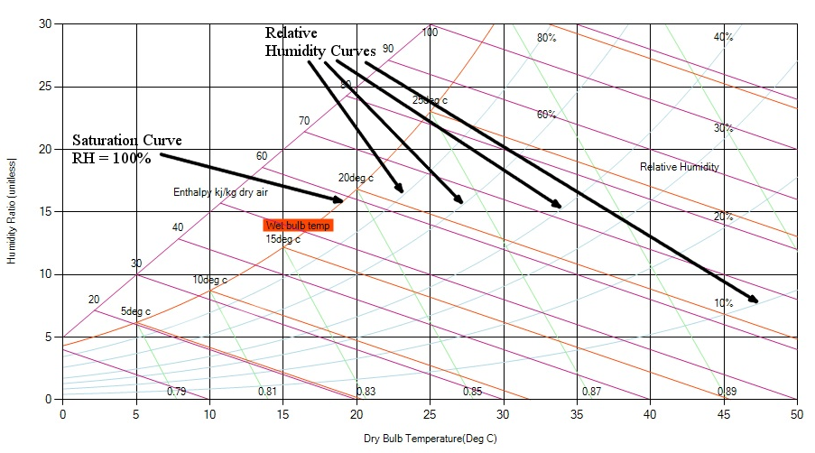

[Relative humidity](https://en.wikipedia.org/wiki/Relative_humidity)  is the ratio of the fraction of water vapor in the air to the fraction of saturated moist air at the same temperature and pressure. RH is dimensionless, and is usually expressed as a percentage. 100% RH indicates the air is saturated and cannot hold any more moisture. Preferred values of comfort for people are between 35% and 60%.

Warmer air can hold more moisture than cold air. Air at 60 percent relative humidity contains 60 percent of the water it could possibly hold (at that temperature). It could pick up 40 percent more water to reach saturation. Lines of constant relative humidity are represented by the curved lines running from the bottom left and sweeping up through to the top right of the chart. The line for 100 percent relative humidity, or saturation, is the upper, left boundary of the chart.

Fig: Relative humidity curve on a psychrometric chart
