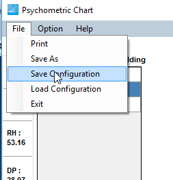
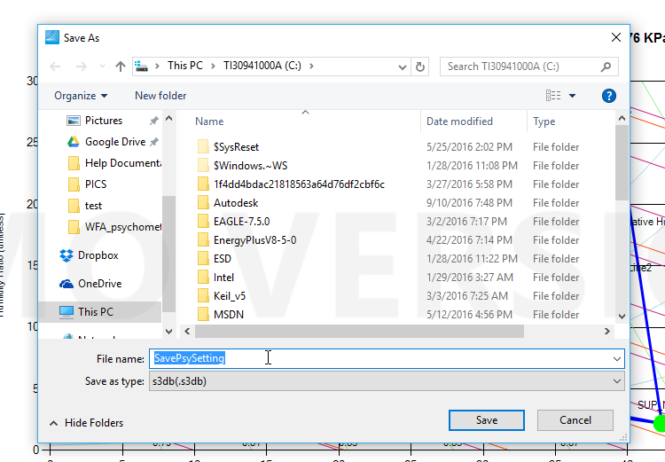
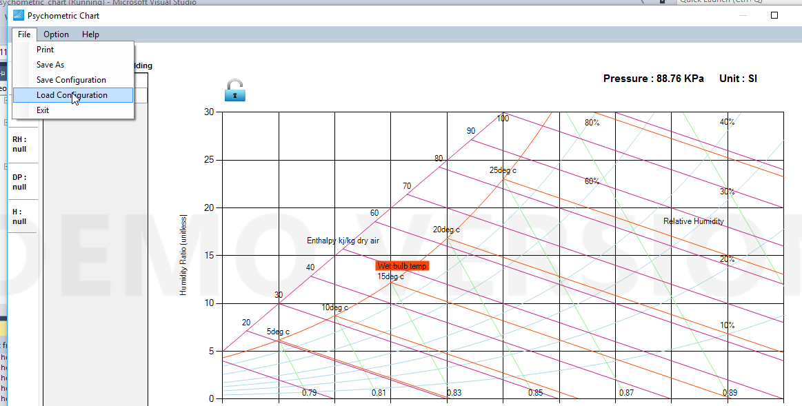
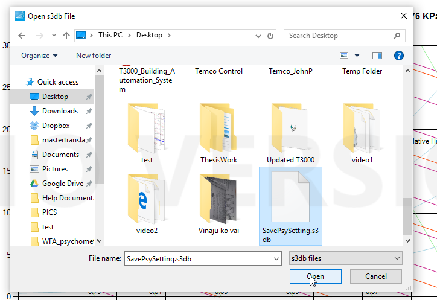
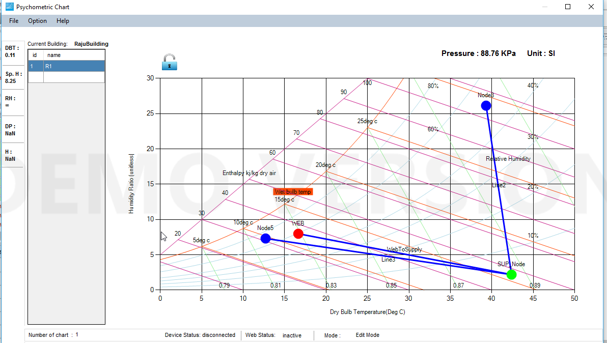

You can save all your work and load later if you wish. It saves all the configurations of nodes, air handlers, process lines, comfort zones , building information.

Once you load the file, you can get the saved configuration.

Note: The configuration will be saved in SQLite file format

For this feature, go to 'Save Configuration' and 'Load Configuration' under File Menue.

Save screenshots

Save the configuration

Save in your desired location as '.s3db' format

Load Screenshots

Load the configuration. Here you can see we have blank chart

Select the desired configuration file to load

After selecting the saved configuration file, we got the following chart that we had saved before. Please note that chart was blank before loading.

Note: In the screenshot, we have shown for a single air handler. It works same if you have many air handlers and many nodes.
