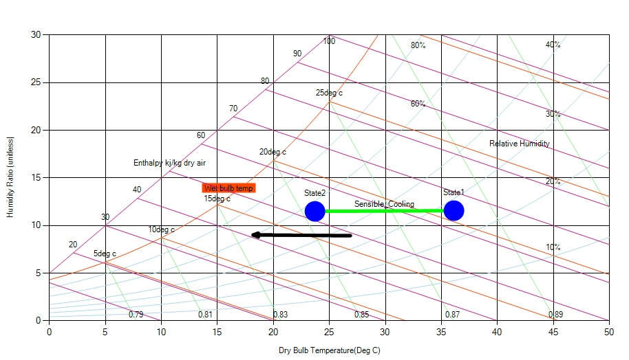

In contrast to sensible heating, sensible cooling is just an opposite process in which the temperature of air is decreased without changing its moisture content. In other words sensible cooling is the process in which pure heat is removed from the air. During this process the sensible heat, dry-bulb and wet-bulb temperature of the air decreases other all remaining constant.

In case of sensible cooling we can see status point moving horizontally to the left on a psychrometric chart. Note that while the AH (represented on the y axis) does not change, the change in temperature means the relative humidity (RH) changes.

Fig: Nature of Sensible Cooling in the chart
