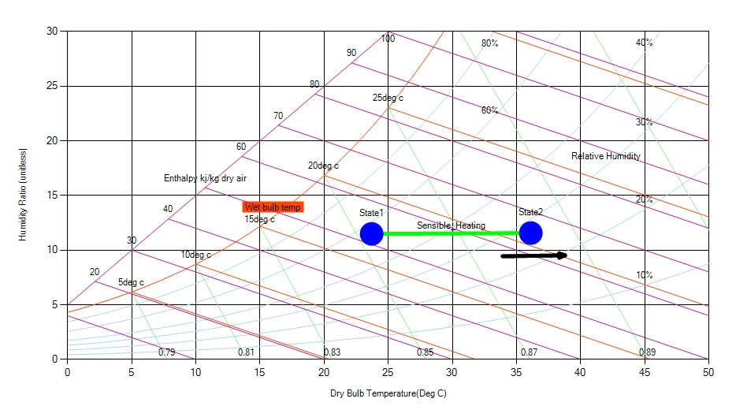

In sensible heating process the temperature of air is increased without changing its moisture content. In other words sensible heating is the process in which pure heat is added into the air. During this process the sensible heat, dry-bulb and wet-bulb temperature of the air increases other all remaining constant.

In case of sensible heating we can see status point moving horizontally to the right on a psychrometric chart. Note that while the AH (represented on the y axis) does not change, the change in temperature means the relative humidity (RH) changes.

Fig: Nature of Sensible Heating on the chart
