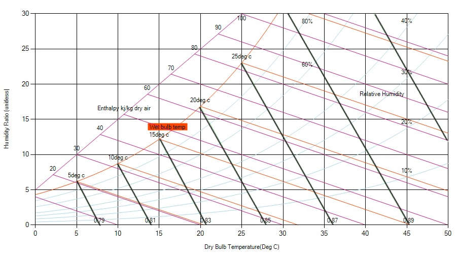

Specific volume indicates the space occupied by air. It is the reciprocal of density and is expressed as a volume per unit weight in m3/kg (density is weight per unit volume). Warm air is less dense than cool air, which causes warmed air to rise. This phenomenon is known as thermal buoyancy. By similar reasoning, warmer air has greater specific volume and is hence lighter than cool air. On the psychrometric chart, lines of constant specific volume are almost vertical lines with scale values written above the dry-bulb temperature scale. Greater specific volume is associated with warmer temperatures (dry-bulb).

Fig: Lines of constant Specefic volumes on a psychrometric chart
