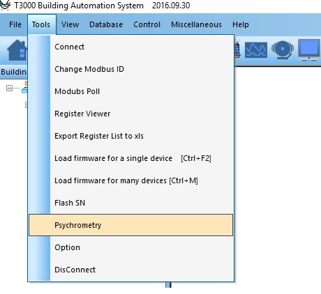
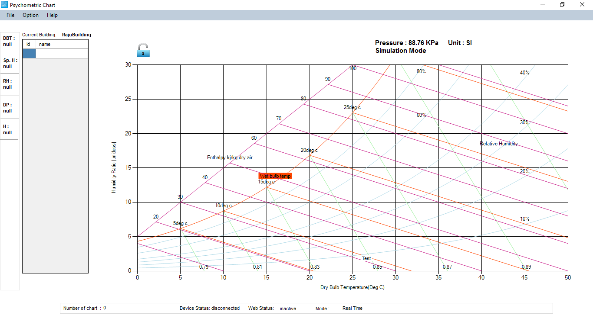

To enter the Temco Psychromentric Tool, click on 'Psyschrometric' under Tools in T3000 software.

Psychrometric Tool apllication will appear as :

This is blank chart. The very basic thing we need to understand that this chart shows the Psychrometric behaviour of currently selected building in T3000. For example, the current selected building is 'RajuBuilding'. The chart is drawn based on selected building location pressure. For example, the selected building 'RajuBuilding' has 88.78KPa. If you chhose different building in T3000, you will get different current building and different chart based on new selected building location pressure.

Each components of charts are described in next section.
