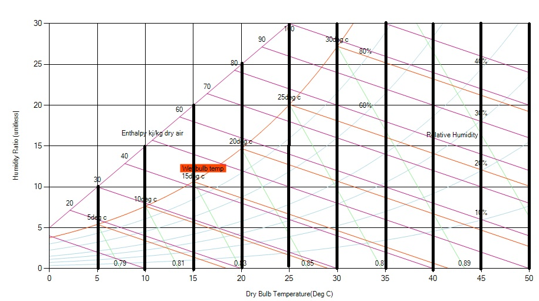

The [dry-bulb temperature (DBT)](https://en.wikipedia.org/wiki/Dry-bulb_temperature) is the most commonly measured air temperature by a thermometer freely exposed to the air but protected  from radiation and moisture. DBT is the temperature that is usually thought of as air temperature, and it is the true thermodynamic temperature. It indicates the amount of heat in the air and is directly proportional to the average kinetic energy of the air molecules.

It is called "dry-bulb" since the sensing tip of the alcoholic thermometer is dry (see wet bulb temperature for comparison). In a psychometric chart the horizontal x-axis represents the dry-bulb temperature and the vertical lines to the axis are lines of constant temperature. In the figure below vertical black lines are the constant DBT lines. It is the most commonly temperature used, therefore it can be assumed that temperatures are dry-bulb temperatures unless particularly designated.

Fig : Dry-bulb Temperature in a psychrometric chart
